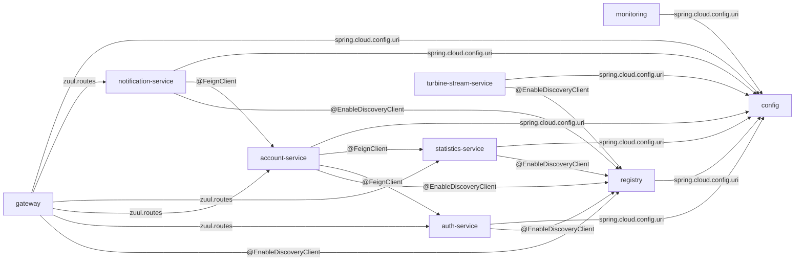
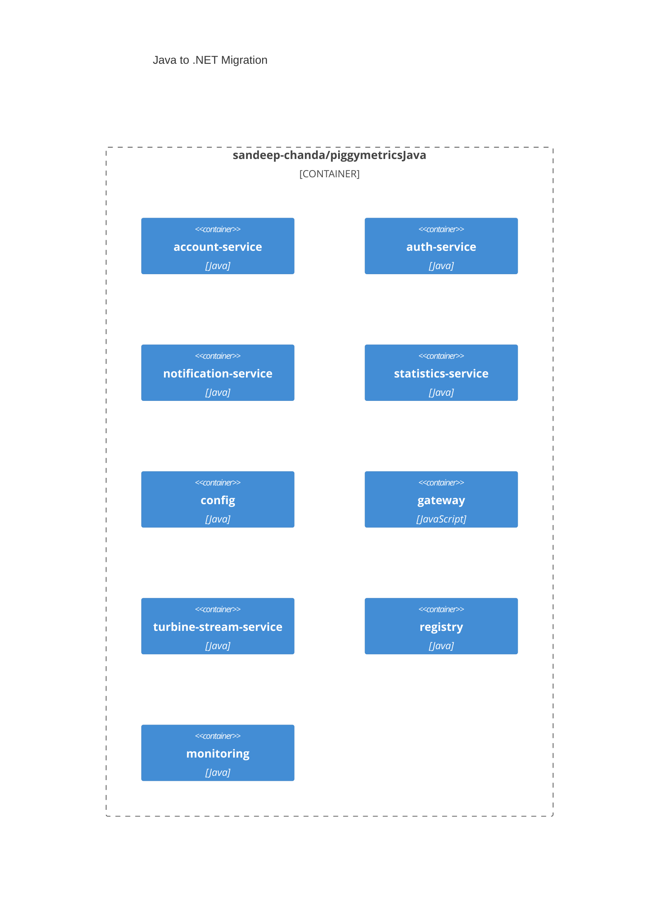
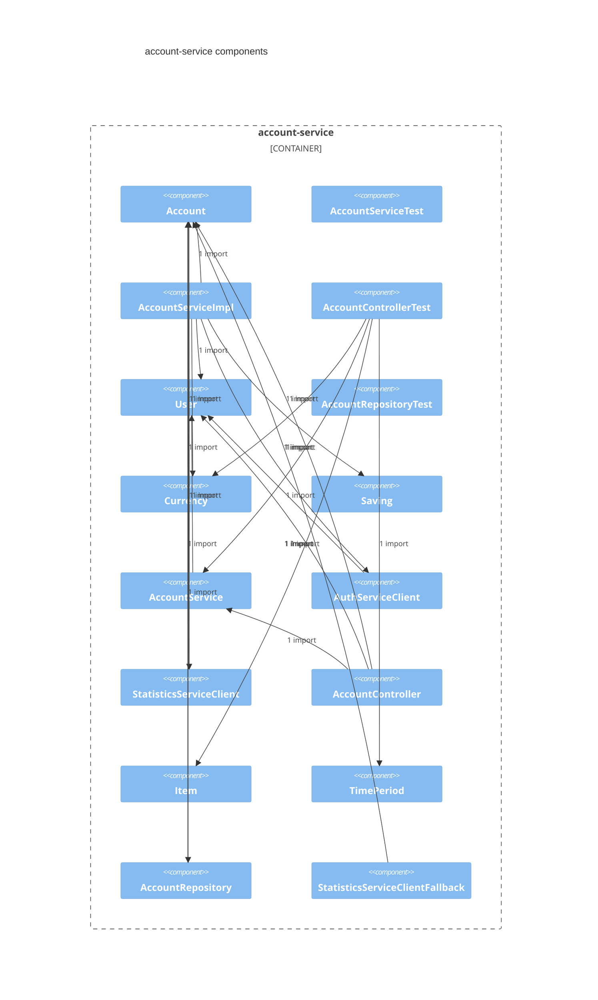
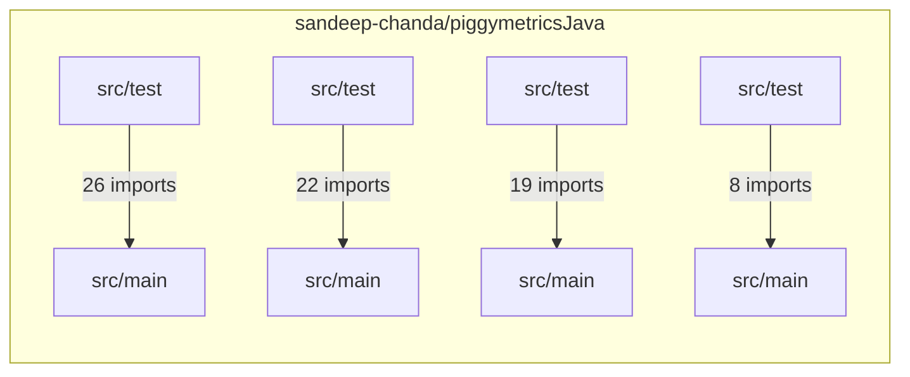

# Java to .NET Migration

## Intent
### Intent

Migrate the Java code from the source repo to .NET

### Pre-conditions

- ends · piggymetricsJava → PiggyMetricsDotNet · separate_repo · PiggyMetricsDotNet is not indexed

## Decisions
```decision
chosen: Spring Cloud → ASP.NET Core | the destination is .NET; the source stack is Spring Boot / Spring Cloud
chosen: Eureka → none | service URLs are configured, not discovered
chosen: Feign → HttpClient | keep every HTTP edge with its path and media type, drop the interface proxy
chosen: Zuul → YARP | the same prefix routes; a direct-URL route stays a direct URL
chosen: Spring Security OAuth → ASP.NET Identity | the same grants and scopes on the destination's own identity stack
chosen: Hystrix → Polly | the same timeout and fallback per edge as a policy on the typed client
chosen: Spring Cloud Config → appsettings.json + environment | configuration per service; secrets from the environment; no config server to start first
chosen: Turbine → OpenTelemetry | metrics per service to a collector; no stream aggregator
chosen: runtime · one unit per runtime service | answered in the Brief · keeps: each service deploys and scales alone, as the source's do; Shared is the only coupling
chosen: gateway · a gateway with the same route prefixes | answered in the Brief · keeps: the route table lives in the gateway project's configuration; the static UI moves host only
chosen: discovery · none · service addresses are configuration | answered in the Brief · keeps: every callee address is a setting; adding an instance changes configuration, not a registry
chosen: configuration · configuration per service + environment | answered in the Brief · keeps: the config module is retired; each service owns its settings file and reads secrets from the environment
chosen: calls · an HTTP client per edge · timeout matching the source | answered in the Brief · keeps: each edge keeps the source's timeout and failure behaviour in code the service owns
chosen: persistence · the same databases and collections | answered in the Brief · keeps: the destination reads and writes the source's collections in place; no data migration and no rollback of data
chosen: auth · the same grants and scopes | answered in the Brief · keeps: tokens keep the source's grants and scopes; resource servers validate the way they do today
chosen: resilience · health endpoints | answered in the Brief · keeps: the dashboard and metrics stream are retired; health and telemetry come from the platform
chosen: scheduling · a scheduler per cron | answered in the Brief · keeps: each cron runs inside its service as a hosted service; no scheduler store to migrate
rejected: Keep the services on Spring Boot and only re-host them | no rewrite, the Java build keeps working | the migration's destination is a .NET repository — the Brief set it
rejected: Run a discovery client on the destination (Steeltoe) | keeps the registry the source already runs | carries a Java registry into a .NET estate for nine fixed services
rejected: Generate typed clients from the source controllers | one client per contract, checked at build time | no contract file exists in the source index to generate from
rejected: Keep the Java gateway in front of the destination services | no route change during the waves | a Java hop stays live after Cutover
rejected: Keep the Java auth service as the token issuer | no re-issue of tokens during the waves | one source module survives Cutover
rejected: No breaker on the destination; let the call fail | one fewer library | the fallback behaviour the source's callers rely on
rejected: Run a config server on the destination | keeps the shared yaml layout | a start-order dependency the source's fail-fast makes fatal
rejected: Keep the Java dashboard reading the destination | no new tooling | a Java module that outlives the cutover
rejected: one monolith project · a worker per service without ASP.NET Core | one process to build, run and debug; no call between services to fail | gives up that each service deploys and scales alone, as the source's do; Shared is the only coupling
rejected: Ocelot · an edge proxy outside the solution (nginx, Envoy) | a proxy the platform already runs; no gateway code to port | gives up that the route table lives in the gateway project's configuration; the static UI moves host only
rejected: Consul · Kubernetes DNS · Steeltoe discovery | instances register themselves; addresses are not settings to keep in step | gives up that every callee address is a setting; adding an instance changes configuration, not a registry
rejected: a config service (Azure App Configuration, Consul KV) · keep the config server | one place changes a setting for every service, as the source does today | gives up that the config module is retired; each service owns its settings file and reads secrets from the environment
rejected: Refit typed clients · gRPC (changes the contract) · a service mesh for timeouts | typed clients or a mesh take the retry and timeout code out of each service | gives up that each edge keeps the source's timeout and failure behaviour in code the service owns
rejected: EF Core with a Mongo provider · a relational store (changes the data map) | a store or an ORM the team already knows, with its migration tooling | gives up that the destination reads and writes the source's collections in place; no data migration and no rollback of data
rejected: Duende IdentityServer (commercial licence) · an external identity provider (changes the token endpoint) | a supported identity product; issuing and rotating tokens is not this codebase's to maintain | gives up that tokens keep the source's grants and scopes; resource servers validate the way they do today
rejected: Steeltoe · keep the dashboard and metrics stream on the source until cutover | the dashboard and metrics stream keep working on the source until cutover; nothing to rebuild first | gives up that the dashboard and metrics stream are retired; health and telemetry come from the platform
rejected: Quartz.NET · Hangfire · a platform cron calling an endpoint | a scheduler with a store survives restarts and spreads jobs across instances | gives up that each cron runs inside its service as a hosted service; no scheduler store to migrate
```

## Source facts
### Summary

piggymetricsJava is 9 Maven modules (account-service, auth-service, config, gateway, monitoring, notification-service, registry, statistics-service, turbine-stream-service) · 97 Java files on spring-boot-starter-parent 2.0.3.RELEASE · Java 1.8. 5 runtime services carry behaviour (gateway, auth-service, account-service, statistics-service, notification-service); 4 infrastructure modules exist for the platform (config (config-server), monitoring (dashboard), registry (registry), turbine-stream-service (metrics-stream)) and become platform decisions, not units. The read states 12 HTTP endpoints, 4 stored collections, 4 outbound clients, 2 scheduled jobs, 4 OAuth clients and 59 tests in 25 classes. PiggyMetricsDotNet is the destination on .NET: it is written by this spec as proposals (the Target shape, the contract and data mappings), never read as evidence.

### Inventory

- piggymetricsJava · 9 modules · 72 main files · 5 runtime services · 4 infrastructure modules → PiggyMetricsDotNet · .NET · proposed
- config · infrastructure · config-server · 2 files → retire · configuration per service · default
- monitoring · infrastructure · dashboard · 1 file → retire · health checks and metrics · default
- registry · infrastructure · registry · 1 file → retire · addresses are configuration · default
- gateway · runtime · 0 endpoints · 1 file · 2 tests → Gateway · proposed
- auth-service · runtime · 3 endpoints · 9 files · 9 tests → AuthService · proposed
- account-service · runtime · 4 endpoints · 17 files · 14 tests → AccountService · proposed
- statistics-service · runtime · 3 endpoints · 23 files · 16 tests → StatisticsService · proposed
- notification-service · runtime · 2 endpoints · 17 files · 16 tests → NotificationService · proposed
- turbine-stream-service · infrastructure · metrics-stream · 1 file → retire · health checks and metrics · default

### Services

- config · infrastructure · config-server · port 8888 · no tests
- monitoring · infrastructure · dashboard · 1 test
- registry · infrastructure · registry · port 8761 · no tests
- gateway · runtime · gateway · port 4000 · 2 tests
- auth-service · runtime · port 5000 · /uaa · users on auth-mongodb · 3 endpoints · 1 collection · authorization server · 9 tests
- account-service · runtime · port 6000 · /accounts · accounts on account-mongodb · 4 endpoints · 1 collection · 2 clients · resource server · 14 tests
- statistics-service · runtime · port 7000 · /statistics · datapoints on statistics-mongodb · 3 endpoints · 1 collection · 1 client · resource server · 16 tests
- notification-service · runtime · port 8000 · /notifications · recipients on notification-mongodb · 2 endpoints · 1 collection · 1 client · 2 jobs · resource server · 16 tests
- turbine-stream-service · infrastructure · metrics-stream · 1 test

### Contract

- C1 · GET /uaa/users/current · user → Principal · UserController.getUser · auth-service/src/main/java/com/piggymetrics/auth/controller/UserController.java:L22
- C2 · POST /uaa/users · server · User (validated) → void · UserController.createUser · auth-service/src/main/java/com/piggymetrics/auth/controller/UserController.java:L28
- C3 · POST /uaa/oauth/token · client basic auth · grant_type=client_credentials | password | refresh_token → token · framework · TokenEndpoint
- C4 · GET /accounts/{name} · server, or name == demo → Account · AccountController.getAccountByName · account-service/src/main/java/com/piggymetrics/account/controller/AccountController.java:L20
- C5 · GET /accounts/current · user → Account · AccountController.getCurrentAccount · account-service/src/main/java/com/piggymetrics/account/controller/AccountController.java:L25
- C6 · PUT /accounts/current · user · Account (validated) → void · AccountController.saveCurrentAccount · account-service/src/main/java/com/piggymetrics/account/controller/AccountController.java:L30
- C7 · POST /accounts · open · User (validated) → Account · AccountController.createNewAccount · account-service/src/main/java/com/piggymetrics/account/controller/AccountController.java:L35
- C8 · GET /statistics/current · user → List<DataPoint> · StatisticsController.getCurrentAccountStatistics · statistics-service/src/main/java/com/piggymetrics/statistics/controller/StatisticsController.java:L20
- C9 · GET /statistics/{accountName} · server, or accountName == demo → List<DataPoint> · StatisticsController.getStatisticsByAccountName · statistics-service/src/main/java/com/piggymetrics/statistics/controller/StatisticsController.java:L26
- C10 · PUT /statistics/{accountName} · server · Account (validated) → void · StatisticsController.saveAccountStatistics · statistics-service/src/main/java/com/piggymetrics/statistics/controller/StatisticsController.java:L32
- C11 · GET /notifications/recipients/current · user → Object · RecipientController.getCurrentNotificationsSettings · notification-service/src/main/java/com/piggymetrics/notification/controller/RecipientController.java:L21
- C12 · PUT /notifications/recipients/current · user · Recipient (validated) → Object · RecipientController.saveCurrentNotificationsSettings · notification-service/src/main/java/com/piggymetrics/notification/controller/RecipientController.java:L26

### Data

- users on auth-mongodb · User · _id = username · username: String; password: String · auth-service/src/main/java/com/piggymetrics/auth/domain/User.java:L10
- accounts on account-mongodb · Account · _id = name · name: String; lastSeen: Date; incomes: [Item{title, amount, currency, period, icon}] · @Valid; expenses: [Item{title, amount, currency, period, icon}] · @Valid; saving: Saving{amount, currency, interest, deposit, capitalization} · @Valid @NotNull; note: String · @Length(min = 0, max = 20_000) · account-service/src/main/java/com/piggymetrics/account/domain/Account.java:L13
- accounts · request shape, no repository saves it · Account · incomes: [Item{title, amount, currency, period}] · @Valid @NotNull; expenses: [Item{title, amount, currency, period}] · @Valid @NotNull; saving: Saving{amount, currency, interest, deposit, capitalization} · @Valid @NotNull · statistics-service/src/main/java/com/piggymetrics/statistics/domain/Account.java:L10
- datapoints on statistics-mongodb · DataPoint · _id = id · id: DataPointId{serialVersionUID, account, date}; incomes: [ItemMetric{title, amount}]; expenses: [ItemMetric{title, amount}]; statistics: Map<StatisticMetric, BigDecimal>; rates: Map<Currency, BigDecimal> · statistics-service/src/main/java/com/piggymetrics/statistics/domain/timeseries/DataPoint.java:L15
- recipients on notification-mongodb · Recipient · _id = accountName · accountName: String; email: String · @NotNull @Email; scheduledNotifications: NotificationSettings{active, frequency, lastNotified} · @Valid · notification-service/src/main/java/com/piggymetrics/notification/domain/Recipient.java:L11

### Edges

- E1 · account-service → auth-service · @FeignClient POST /uaa/users · server · propagates · account-service/src/main/java/com/piggymetrics/account/client/AuthServiceClient.java:L9
- E2 · account-service → statistics-service · @FeignClient PUT /statistics/{accountName} · server · fallback · StatisticsServiceClientFallback · account-service/src/main/java/com/piggymetrics/account/client/StatisticsServiceClient.java:L10
- E3 · statistics-service → ${rates.url} · @FeignClient GET /latest · none · fallback · ExchangeRatesClientFallback · statistics-service/src/main/java/com/piggymetrics/statistics/client/ExchangeRatesClient.java:L10
- E4 · notification-service → account-service · @FeignClient GET /accounts/{accountName} · server · caught and logged in NotificationServiceImpl · notification-service/src/main/java/com/piggymetrics/notification/client/AccountServiceClient.java:L9
- E5 · monitoring → config · spring.cloud.config.uri http://config:8888 · basic · fails to start · monitoring/src/main/resources/bootstrap.yml:L6
- E6 · registry → config · spring.cloud.config.uri http://config:8888 · basic · fails to start · registry/src/main/resources/bootstrap.yml:L6
- E7 · gateway → auth-service · zuul.routes /uaa/** · pass-through · by url · config/src/main/resources/shared/gateway.yml:L21
- E8 · gateway → account-service · zuul.routes /accounts/** · pass-through · by serviceId · config/src/main/resources/shared/gateway.yml:L27
- E9 · gateway → statistics-service · zuul.routes /statistics/** · pass-through · by serviceId · config/src/main/resources/shared/gateway.yml:L33
- E10 · gateway → notification-service · zuul.routes /notifications/** · pass-through · by serviceId · config/src/main/resources/shared/gateway.yml:L39
- E11 · gateway → config · spring.cloud.config.uri http://config:8888 · basic · fails to start · gateway/src/main/resources/bootstrap.yml:L6
- E12 · gateway → registry · @EnableDiscoveryClient · none · registers
- E13 · auth-service → config · spring.cloud.config.uri http://config:8888 · basic · fails to start · auth-service/src/main/resources/bootstrap.yml:L6
- E14 · auth-service → registry · @EnableDiscoveryClient · none · registers
- E15 · account-service → config · spring.cloud.config.uri http://config:8888 · basic · fails to start · account-service/src/main/resources/bootstrap.yml:L6
- E16 · account-service → registry · @EnableDiscoveryClient · none · registers
- E17 · account-service → broker · spring-cloud-starter-bus-amqp, spring-cloud-netflix-hystrix-stream rabbitmq · none · metrics and bus only · config/src/main/resources/shared/application.yml:L27
- E18 · account-service → auth · user-info-uri http://auth-service:5000/uaa/users/current · bearer · invalid token → 401 · config/src/main/resources/shared/application.yml:L23
- E19 · statistics-service → config · spring.cloud.config.uri http://config:8888 · basic · fails to start · statistics-service/src/main/resources/bootstrap.yml:L6
- E20 · statistics-service → registry · @EnableDiscoveryClient · none · registers
- E21 · statistics-service → broker · spring-cloud-starter-bus-amqp, spring-cloud-netflix-hystrix-stream rabbitmq · none · metrics and bus only · config/src/main/resources/shared/application.yml:L27
- E22 · statistics-service → auth · user-info-uri http://auth-service:5000/uaa/users/current · bearer · invalid token → 401 · config/src/main/resources/shared/application.yml:L23
- E23 · notification-service → config · spring.cloud.config.uri http://config:8888 · basic · fails to start · notification-service/src/main/resources/bootstrap.yml:L6
- E24 · notification-service → registry · @EnableDiscoveryClient · none · registers
- E25 · notification-service → broker · spring-cloud-starter-bus-amqp, spring-cloud-netflix-hystrix-stream rabbitmq · none · metrics and bus only · config/src/main/resources/shared/application.yml:L27
- E26 · notification-service → auth · user-info-uri http://auth-service:5000/uaa/users/current · bearer · invalid token → 401 · config/src/main/resources/shared/application.yml:L23
- E27 · turbine-stream-service → config · spring.cloud.config.uri http://config:8888 · basic · fails to start · turbine-stream-service/src/main/resources/bootstrap.yml:L6
- E28 · turbine-stream-service → registry · @EnableDiscoveryClient · none · registers
- E29 · turbine-stream-service → broker · spring-cloud-starter-netflix-turbine-stream, spring-cloud-starter-stream-rabbit rabbitmq · none · metrics and bus only · config/src/main/resources/shared/application.yml:L27

### Non-functional requirements

- account-service · `spring.cloud.config.fail-fast: true` — fails fast when the config server is unreachable · fail-fast on · account-service/src/main/resources/bootstrap.yml:L7
- auth-service · `spring.cloud.config.fail-fast: true` — fails fast when the config server is unreachable · fail-fast on · auth-service/src/main/resources/bootstrap.yml:L7
- account-service · `spring.data.mongodb.host: account-mongodb` — the service's own store · config/src/main/resources/shared/account-service.yml:L13
- account-service · `feign.hystrix.enabled: true` — circuit breaker · config/src/main/resources/shared/account-service.yml:L26
- every service · `hystrix.command.default.execution.isolation.thread.timeoutInMilliseconds: 10000` — 10 s timeout · config/src/main/resources/shared/application.yml:L11
- every service · `spring.rabbitmq.host: rabbitmq` — message broker · config/src/main/resources/shared/application.yml:L27
- auth-service · `spring.data.mongodb.host: auth-mongodb` — the service's own store · config/src/main/resources/shared/auth-service.yml:L4
- gateway · `hystrix.command.default.execution.isolation.thread.timeoutInMilliseconds: 20000` — 20 s timeout · config/src/main/resources/shared/gateway.yml:L7
- gateway · `ribbon.ReadTimeout: 20000` — 20 s timeout · config/src/main/resources/shared/gateway.yml:L10
- gateway · `ribbon.ConnectTimeout: 20000` — 20 s timeout · config/src/main/resources/shared/gateway.yml:L11
- gateway · `zuul.host.connect-timeout-millis: 20000` — 20 s timeout · config/src/main/resources/shared/gateway.yml:L16
- gateway · `zuul.host.socket-timeout-millis: 20000` — 20 s timeout · config/src/main/resources/shared/gateway.yml:L17
- notification-service · `spring.data.mongodb.host: notification-mongodb` — the service's own store · config/src/main/resources/shared/notification-service.yml:L31
- statistics-service · `spring.data.mongodb.host: statistics-mongodb` — the service's own store · config/src/main/resources/shared/statistics-service.yml:L13
- gateway · `spring.cloud.config.fail-fast: true` — fails fast when the config server is unreachable · fail-fast on · gateway/src/main/resources/bootstrap.yml:L7
- monitoring · `spring.cloud.config.fail-fast: true` — fails fast when the config server is unreachable · fail-fast on · monitoring/src/main/resources/bootstrap.yml:L7
- notification-service · `spring.cloud.config.fail-fast: true` — fails fast when the config server is unreachable · fail-fast on · notification-service/src/main/resources/bootstrap.yml:L7
- registry · `spring.cloud.config.fail-fast: true` — fails fast when the config server is unreachable · fail-fast on · registry/src/main/resources/bootstrap.yml:L7
- statistics-service · `spring.cloud.config.fail-fast: true` — fails fast when the config server is unreachable · fail-fast on · statistics-service/src/main/resources/bootstrap.yml:L7
- turbine-stream-service · `spring.cloud.config.fail-fast: true` — fails fast when the config server is unreachable · fail-fast on · turbine-stream-service/src/main/resources/bootstrap.yml:L7
- one store per service — 4 modules carry 4 distinct datasource hosts: account-service → account-mongodb, auth-service → auth-mongodb, notification-service → notification-mongodb, statistics-service → statistics-mongodb · config/src/main/resources/shared/account-service.yml:L13 · config/src/main/resources/shared/auth-service.yml:L4 · config/src/main/resources/shared/notification-service.yml:L31 · config/src/main/resources/shared/statistics-service.yml:L13
- Observability: no target stated

### Impacted assets

- sandeep-chanda/piggymetricsJava · config/src/main/resources/application.yml
- sandeep-chanda/piggymetricsJava · config/src/main/resources/shared/registry.yml
- sandeep-chanda/piggymetricsJava · config/src/main/resources/shared/gateway.yml
- sandeep-chanda/piggymetricsJava · auth-service/src/main/java/com/piggymetrics/auth/controller/UserController.java
- sandeep-chanda/piggymetricsJava · auth-service/src/main/java/com/piggymetrics/auth/config/OAuth2AuthorizationConfig.java
- sandeep-chanda/piggymetricsJava · auth-service/src/main/java/com/piggymetrics/auth/domain/User.java
- sandeep-chanda/piggymetricsJava · auth-service/src/main/java/com/piggymetrics/auth/repository/UserRepository.java
- sandeep-chanda/piggymetricsJava · config/src/main/resources/shared/auth-service.yml
- sandeep-chanda/piggymetricsJava · account-service/src/main/java/com/piggymetrics/account/controller/AccountController.java
- sandeep-chanda/piggymetricsJava · account-service/src/main/java/com/piggymetrics/account/domain/Account.java
- sandeep-chanda/piggymetricsJava · account-service/src/main/java/com/piggymetrics/account/repository/AccountRepository.java
- sandeep-chanda/piggymetricsJava · account-service/src/main/java/com/piggymetrics/account/client/AuthServiceClient.java
- sandeep-chanda/piggymetricsJava · account-service/src/main/java/com/piggymetrics/account/client/StatisticsServiceClient.java
- sandeep-chanda/piggymetricsJava · config/src/main/resources/shared/account-service.yml
- sandeep-chanda/piggymetricsJava · statistics-service/src/main/java/com/piggymetrics/statistics/controller/StatisticsController.java
- sandeep-chanda/piggymetricsJava · statistics-service/src/main/java/com/piggymetrics/statistics/domain/Account.java
- sandeep-chanda/piggymetricsJava · statistics-service/src/main/java/com/piggymetrics/statistics/domain/timeseries/DataPoint.java
- sandeep-chanda/piggymetricsJava · statistics-service/src/main/java/com/piggymetrics/statistics/repository/DataPointRepository.java
- sandeep-chanda/piggymetricsJava · statistics-service/src/main/java/com/piggymetrics/statistics/client/ExchangeRatesClient.java
- sandeep-chanda/piggymetricsJava · config/src/main/resources/shared/statistics-service.yml
- sandeep-chanda/piggymetricsJava · notification-service/src/main/java/com/piggymetrics/notification/controller/RecipientController.java
- sandeep-chanda/piggymetricsJava · notification-service/src/main/java/com/piggymetrics/notification/domain/Recipient.java
- sandeep-chanda/piggymetricsJava · notification-service/src/main/java/com/piggymetrics/notification/repository/RecipientRepository.java
- sandeep-chanda/piggymetricsJava · notification-service/src/main/java/com/piggymetrics/notification/client/AccountServiceClient.java
- sandeep-chanda/piggymetricsJava · notification-service/src/main/java/com/piggymetrics/notification/service/NotificationServiceImpl.java
- sandeep-chanda/piggymetricsJava · config/src/main/resources/shared/notification-service.yml
- sandeep-chanda/piggymetricsJava · account-service/pom.xml
- sandeep-chanda/piggymetricsJava · auth-service/pom.xml
- sandeep-chanda/piggymetricsJava · config/pom.xml
- sandeep-chanda/piggymetricsJava · gateway/pom.xml
- sandeep-chanda/piggymetricsJava · monitoring/pom.xml
- sandeep-chanda/piggymetricsJava · notification-service/pom.xml
- {'repo_slug': 'sandeep-chanda/piggymetricsJava'}
- sandeep-chanda/piggymetricsJava · registry/pom.xml
- sandeep-chanda/piggymetricsJava · statistics-service/pom.xml
- sandeep-chanda/piggymetricsJava · turbine-stream-service/pom.xml

### Code highlights

- `account-service/src/main/java/com/piggymetrics/account/AccountApplication.java:L12` · @EnableDiscoveryClient
- `account-service/src/main/java/com/piggymetrics/account/AccountApplication.java:L13` · @EnableOAuth2Client
- `account-service/src/main/java/com/piggymetrics/account/AccountApplication.java:L14` · @EnableFeignClients
- `account-service/src/main/java/com/piggymetrics/account/AccountApplication.java:L15` · @EnableCircuitBreaker
- `account-service/src/main/java/com/piggymetrics/account/AccountApplication.java:L16` · @EnableGlobalMethodSecurity
- `auth-service/src/main/java/com/piggymetrics/auth/AuthApplication.java:L10` · @EnableResourceServer
- `auth-service/src/main/java/com/piggymetrics/auth/AuthApplication.java:L11` · @EnableDiscoveryClient
- `auth-service/src/main/java/com/piggymetrics/auth/AuthApplication.java:L12` · @EnableGlobalMethodSecurity
- `config/src/main/java/com/piggymetrics/config/ConfigApplication.java:L8` · @EnableConfigServer
- `gateway/src/main/java/com/piggymetrics/gateway/GatewayApplication.java:L9` · @EnableDiscoveryClient
- `gateway/src/main/java/com/piggymetrics/gateway/GatewayApplication.java:L10` · @EnableZuulProxy
- `monitoring/src/main/java/com/piggymetrics/monitoring/MonitoringApplication.java:L8` · @EnableHystrixDashboard
- `notification-service/src/main/java/com/piggymetrics/notification/NotificationServiceApplication.java:L19` · @EnableDiscoveryClient
- `notification-service/src/main/java/com/piggymetrics/notification/NotificationServiceApplication.java:L20` · @EnableOAuth2Client
- `notification-service/src/main/java/com/piggymetrics/notification/NotificationServiceApplication.java:L21` · @EnableFeignClients
- `notification-service/src/main/java/com/piggymetrics/notification/NotificationServiceApplication.java:L22` · @EnableGlobalMethodSecurity
- `notification-service/src/main/java/com/piggymetrics/notification/NotificationServiceApplication.java:L23` · @EnableScheduling
- `registry/src/main/java/com/piggymetrics/registry/RegistryApplication.java:L8` · @EnableEurekaServer
- `statistics-service/src/main/java/com/piggymetrics/statistics/StatisticsApplication.java:L22` · @EnableDiscoveryClient
- `statistics-service/src/main/java/com/piggymetrics/statistics/StatisticsApplication.java:L23` · @EnableOAuth2Client
- `statistics-service/src/main/java/com/piggymetrics/statistics/StatisticsApplication.java:L24` · @EnableFeignClients
- `statistics-service/src/main/java/com/piggymetrics/statistics/StatisticsApplication.java:L25` · @EnableGlobalMethodSecurity
- `turbine-stream-service/src/main/java/com/piggymetrics/turbine/TurbineStreamServiceApplication.java:L9` · @EnableTurbineStream
- `turbine-stream-service/src/main/java/com/piggymetrics/turbine/TurbineStreamServiceApplication.java:L10` · @EnableDiscoveryClient
- `account-service/src/main/java/com/piggymetrics/account/client/AuthServiceClient.java:L9` · @FeignClient(name = "auth-service")
- `account-service/src/main/java/com/piggymetrics/account/client/StatisticsServiceClient.java:L10` · @FeignClient(name = "statistics-service")
- `notification-service/src/main/java/com/piggymetrics/notification/client/AccountServiceClient.java:L9` · @FeignClient(name = "account-service")
- `statistics-service/src/main/java/com/piggymetrics/statistics/client/ExchangeRatesClient.java:L10` · @FeignClient(url = "${rates.url}", name = "rates-client")
- `account-service/src/main/java/com/piggymetrics/account/controller/AccountController.java:L20` · @RequestMapping(path = "/{name}", method = RequestMethod.GET)
- `account-service/src/main/java/com/piggymetrics/account/controller/AccountController.java:L25` · @RequestMapping(path = "/current", method = RequestMethod.GET)
- `account-service/src/main/java/com/piggymetrics/account/controller/AccountController.java:L30` · @RequestMapping(path = "/current", method = RequestMethod.PUT)
- `account-service/src/main/java/com/piggymetrics/account/controller/AccountController.java:L35` · @RequestMapping(path = "/", method = RequestMethod.POST)
- `auth-service/src/main/java/com/piggymetrics/auth/controller/UserController.java:L16` · @RequestMapping("/users")
- `auth-service/src/main/java/com/piggymetrics/auth/controller/UserController.java:L22` · @RequestMapping(value = "/current", method = RequestMethod.GET)
- `auth-service/src/main/java/com/piggymetrics/auth/controller/UserController.java:L28` · @RequestMapping(method = RequestMethod.POST)
- `notification-service/src/main/java/com/piggymetrics/notification/controller/RecipientController.java:L15` · @RequestMapping("/recipients")
- `notification-service/src/main/java/com/piggymetrics/notification/controller/RecipientController.java:L21` · @RequestMapping(path = "/current", method = RequestMethod.GET)
- `notification-service/src/main/java/com/piggymetrics/notification/controller/RecipientController.java:L26` · @RequestMapping(path = "/current", method = RequestMethod.PUT)
- `statistics-service/src/main/java/com/piggymetrics/statistics/controller/StatisticsController.java:L20` · @RequestMapping(value = "/current", method = RequestMethod.GET)
- `statistics-service/src/main/java/com/piggymetrics/statistics/controller/StatisticsController.java:L26` · @RequestMapping(value = "/{accountName}", method = RequestMethod.GET)
- `statistics-service/src/main/java/com/piggymetrics/statistics/controller/StatisticsController.java:L32` · @RequestMapping(value = "/{accountName}", method = RequestMethod.PUT)
- `config/src/main/resources/shared/gateway.yml:L20` · zuul.routes.auth-service · /uaa/**
- `config/src/main/resources/shared/gateway.yml:L26` · zuul.routes.account-service · /accounts/**
- `config/src/main/resources/shared/gateway.yml:L32` · zuul.routes.statistics-service · /statistics/**
- `config/src/main/resources/shared/gateway.yml:L38` · zuul.routes.notification-service · /notifications/**

## Target shape
- PiggyMetricsDotNet · .NET · proposed; nothing here is a cited path
- runtime · one unit per runtime service · answered · instead of: one monolith project · a worker per service without ASP.NET Core · so: each service deploys and scales alone, as the source's do; Shared is the only coupling
- gateway · a gateway with the same route prefixes · answered · instead of: Ocelot · an edge proxy outside the solution (nginx, Envoy) · so: the route table lives in the gateway project's configuration; the static UI moves host only
- discovery · none · service addresses are configuration · answered · instead of: Consul · Kubernetes DNS · Steeltoe discovery · so: every callee address is a setting; adding an instance changes configuration, not a registry
- configuration · configuration per service + environment · answered · instead of: a config service (Azure App Configuration, Consul KV) · keep the config server · so: the config module is retired; each service owns its settings file and reads secrets from the environment
- calls · an HTTP client per edge · timeout matching the source · answered · instead of: Refit typed clients · gRPC (changes the contract) · a service mesh for timeouts · so: each edge keeps the source's timeout and failure behaviour in code the service owns
- persistence · the same databases and collections · answered · instead of: EF Core with a Mongo provider · a relational store (changes the data map) · so: the destination reads and writes the source's collections in place; no data migration and no rollback of data
- auth · the same grants and scopes · answered · instead of: Duende IdentityServer (commercial licence) · an external identity provider (changes the token endpoint) · so: tokens keep the source's grants and scopes; resource servers validate the way they do today
- resilience · health endpoints · answered · instead of: Steeltoe · keep the dashboard and metrics stream on the source until cutover · so: the dashboard and metrics stream are retired; health and telemetry come from the platform
- scheduling · a scheduler per cron · answered · instead of: Quartz.NET · Hangfire · a platform cron calling an endpoint · so: each cron runs inside its service as a hosted service; no scheduler store to migrate
- layout · Shared · gateway → Gateway · auth-service → AuthService · account-service → AccountService · statistics-service → StatisticsService · notification-service → NotificationService
- config (config-server) · retire · configuration per service · default
- monitoring (dashboard) · retire · health checks and metrics · default
- registry (registry) · retire · addresses are configuration · default
- turbine-stream-service (metrics-stream) · retire · health checks and metrics · default

## Contract mapping
- C1 · GET /uaa/users/current → AuthService · UserController.GetUser · policy user · check: GET with a user token → the source's body; without one → 401 · proposed
- C2 · POST /uaa/users → AuthService · UserController.CreateUser · policy server · check: POST with a server token → 200; with a user token → 403 · proposed
- C3 · POST /uaa/oauth/token → AuthService · token endpoint · policy client credentials · check: each grant issues a token the resource servers accept · proposed
- C4 · GET /accounts/{name} → AccountService · AccountController.GetAccountByName · policy server, or name == demo · check: GET with a server token → 200; with a user token → 403; the named exception without a token → 200 · proposed
- C5 · GET /accounts/current → AccountService · AccountController.GetCurrentAccount · policy user · check: GET with a user token → the source's body; without one → 401 · proposed
- C6 · PUT /accounts/current → AccountService · AccountController.SaveCurrentAccount · policy user · check: PUT with a user token → the source's body; without one → 401 · proposed
- C7 · POST /accounts → AccountService · AccountController.CreateNewAccount · policy anonymous · check: POST without a token → the source's status and body · proposed
- C8 · GET /statistics/current → StatisticsService · StatisticsController.GetCurrentAccountStatistics · policy user · check: GET with a user token → the source's body; without one → 401 · proposed
- C9 · GET /statistics/{accountName} → StatisticsService · StatisticsController.GetStatisticsByAccountName · policy server, or accountName == demo · check: GET with a server token → 200; with a user token → 403; the named exception without a token → 200 · proposed
- C10 · PUT /statistics/{accountName} → StatisticsService · StatisticsController.SaveAccountStatistics · policy server · check: PUT with a server token → 200; with a user token → 403 · proposed
- C11 · GET /notifications/recipients/current → NotificationService · RecipientController.GetCurrentNotificationsSettings · policy user · check: GET with a user token → the source's body; without one → 401 · proposed
- C12 · PUT /notifications/recipients/current → NotificationService · RecipientController.SaveCurrentNotificationsSettings · policy user · check: PUT with a user token → the source's body; without one → 401 · proposed

## Data mapping
- users · User → AuthService · User · _id = username · same collection and field names · proposed
- accounts · Account → AccountService · Account · _id = name · embedded Item, Saving · same collection and field names · proposed
- accounts · Account → StatisticsService · Account (request shape) · embedded Item, Saving · same collection and field names · proposed
- datapoints · DataPoint → StatisticsService · DataPoint · _id = id · embedded DataPointId, ItemMetric · same collection and field names · proposed
- recipients · Recipient → NotificationService · Recipient · _id = accountName · embedded NotificationSettings · same collection and field names · proposed

## Scope
### Scope

- In: gateway, auth-service, account-service, statistics-service, notification-service · every endpoint (12), stored collection (4), outbound client (4) and scheduled job (2) the read states
- Platform, not units: config (config-server), monitoring (dashboard), registry (registry), turbine-stream-service (metrics-stream) · each carries a decision in the Target shape
- Out: PiggyMetricsDotNet as evidence · the destination is written as proposals and never cited

### Acceptance criteria

- every project builds and Shared's bearer handler validates a source token
- each service's plan is done: its contract rows replay with the source's status and body
- every contract row holds parity through both gateways
- every route points at the destination and the source runs shadow only
- each retired module is off and nothing reads it
- Given the code as it stands today, when Phase 1 · Skeleton is finished, then every project builds and Shared's bearer handler validates a source token.
- Given the work before Phase 2 · Services is done, when Phase 2 · Services is finished, then each service's plan is done: its contract rows replay with the source's status and body.
- Given the work before Phase 3 · Parity is done, when Phase 3 · Parity is finished, then every contract row holds parity through both gateways.
- Given the work before Phase 4 · Cutover is done, when Phase 4 · Cutover is finished, then every route points at the destination and the source runs shadow only.
- Given the work before Phase 5 · Retirement is done, when Phase 5 · Retirement is finished, then each retired module is off and nothing reads it.

## Plans
### Plans

### P1 · Solution skeleton and Shared
the .NET solution every service plan builds on

- Target: Shared · .NET
- Done when: every project builds; Shared's bearer handler accepts a token the source's authorization server issued and refuses one it did not

1. Solution and one project per runtime service (Gateway, AuthService, AccountService, StatisticsService, NotificationService) plus Shared · .NET · from account-service/pom.xml
2. Shared · bearer handler that validates a token the way the resource servers do · calls http://auth-service:5000/uaa/users/current · account-service/src/main/java/com/piggymetrics/account/config/ResourceServerConfig.java
3. Shared · store conventions and serializers for the documents' field names and ids · the same databases and collections · account-service/src/main/java/com/piggymetrics/account/repository/AccountRepository.java
4. Shared · typed-client base with the source's timeout and a client-credentials token cache · an HTTP client per edge · timeout matching the source
5. Shared · health checks and JSON options (enums as names, unknown fields ignored, the source's date format)

### P2 · AuthService · auth-service
3 endpoints · 1 collection · 0 clients · 0 jobs · 9 tests

- Target: AuthService · .NET · port 5000 · path /uaa · store auth-mongodb
- Depends on: P1
- Rows: Contract C1, C2, C3 · Data users
- Done when: C1–C3 replay through AuthService with the source's status and body (Contract map); the 5 ported test classes (9 tests) are green

1. Port User (users) → AuthService · User · _id = username · fields username, password · same collection and field names · auth-service/src/main/java/com/piggymetrics/auth/domain/User.java:L10
2. Port UserRepository on User → AuthService · UserRepository on auth-mongodb · auth-service/src/main/java/com/piggymetrics/auth/repository/UserRepository.java
3. C1 · GET /uaa/users/current → AuthService · UserController.GetUser · policy user · returns Principal · check: GET with a user token → the source's body; without one → 401 · auth-service/src/main/java/com/piggymetrics/auth/controller/UserController.java:L22
4. C2 · POST /uaa/users → AuthService · UserController.CreateUser · policy server · body User (validated) · returns void · check: POST with a server token → 200; with a user token → 403 · auth-service/src/main/java/com/piggymetrics/auth/controller/UserController.java:L28
5. C3 · POST /uaa/oauth/token → AuthService · token endpoint · policy client credentials · body grant_type=client_credentials | password | refresh_token · returns token · check: each grant issues a token the resource servers accept · auth-service/src/main/java/com/piggymetrics/auth/config/OAuth2AuthorizationConfig.java
6. Authorization server with the 4 clients and their grants and scopes → AuthService · the same grants and scopes · grants client_credentials, password, refresh_token · auth-service/src/main/java/com/piggymetrics/auth/config/OAuth2AuthorizationConfig.java
7. Settings → AuthService · configuration per service + environment · port 5000 · path /uaa · store auth-mongodb/piggymetrics · keys from auth-service/src/main/resources/bootstrap.yml, config/src/main/resources/shared/auth-service.yml
8. Port test AuthServiceApplicationTests · same names and assertions · AuthService.Tests · auth-service/src/test/java/com/piggymetrics/auth/AuthServiceApplicationTests.java
9. Port test UserControllerTest · same names and assertions · AuthService.Tests · auth-service/src/test/java/com/piggymetrics/auth/controller/UserControllerTest.java
10. Port test UserRepositoryTest · same names and assertions · AuthService.Tests · auth-service/src/test/java/com/piggymetrics/auth/repository/UserRepositoryTest.java
11. Port test UserServiceTest · same names and assertions · AuthService.Tests · auth-service/src/test/java/com/piggymetrics/auth/service/UserServiceTest.java
12. Port test MongoUserDetailsServiceTest · same names and assertions · AuthService.Tests · auth-service/src/test/java/com/piggymetrics/auth/service/security/MongoUserDetailsServiceTest.java

### P3 · StatisticsService · statistics-service
3 endpoints · 1 collection · 1 client · 0 jobs · 16 tests

- Target: StatisticsService · .NET · port 7000 · path /statistics · store statistics-mongodb
- Depends on: P1
- Rows: Contract C8, C9, C10 · Data datapoints · Edges E3
- Done when: C8–C10 replay through StatisticsService with the source's status and body (Contract map); E3 behaves as the source when the callee is down; the 6 ported test classes (16 tests) are green

1. Port Account (accounts · shape) → StatisticsService · Account (request shape) · fields incomes, expenses, saving · embedded Item, Saving · same field names · statistics-service/src/main/java/com/piggymetrics/statistics/domain/Account.java:L10
2. Port DataPoint (datapoints) → StatisticsService · DataPoint · _id = id · fields id, incomes, expenses, statistics, rates · embedded DataPointId, ItemMetric · same collection and field names · statistics-service/src/main/java/com/piggymetrics/statistics/domain/timeseries/DataPoint.java:L15
3. Port DataPointRepository on DataPoint → StatisticsService · DataPointRepository on statistics-mongodb · statistics-service/src/main/java/com/piggymetrics/statistics/repository/DataPointRepository.java
4. C8 · GET /statistics/current → StatisticsService · StatisticsController.GetCurrentAccountStatistics · policy user · returns List<DataPoint> · check: GET with a user token → the source's body; without one → 401 · statistics-service/src/main/java/com/piggymetrics/statistics/controller/StatisticsController.java:L20
5. C9 · GET /statistics/{accountName} → StatisticsService · StatisticsController.GetStatisticsByAccountName · policy server, or accountName == demo · returns List<DataPoint> · check: GET with a server token → 200; with a user token → 403; the named exception without a token → 200 · statistics-service/src/main/java/com/piggymetrics/statistics/controller/StatisticsController.java:L26
6. C10 · PUT /statistics/{accountName} → StatisticsService · StatisticsController.SaveAccountStatistics · policy server · body Account (validated) · returns void · check: PUT with a server token → 200; with a user token → 403 · statistics-service/src/main/java/com/piggymetrics/statistics/controller/StatisticsController.java:L32
7. Client for GET /latest on rates-client → StatisticsService typed client · E3 · on failure: fallback · ExchangeRatesClientFallback · the source's timeout · statistics-service/src/main/java/com/piggymetrics/statistics/client/ExchangeRatesClient.java
8. Settings → StatisticsService · configuration per service + environment · port 7000 · path /statistics · store statistics-mongodb/piggymetrics · keys from config/src/main/resources/shared/statistics-service.yml, statistics-service/src/main/resources/bootstrap.yml
9. Port test StatisticsServiceApplicationTests · same names and assertions · StatisticsService.Tests · statistics-service/src/test/java/com/piggymetrics/statistics/StatisticsServiceApplicationTests.java
10. Port test ExchangeRatesClientTest · same names and assertions · StatisticsService.Tests · statistics-service/src/test/java/com/piggymetrics/statistics/client/ExchangeRatesClientTest.java
11. Port test StatisticsControllerTest · same names and assertions · StatisticsService.Tests · statistics-service/src/test/java/com/piggymetrics/statistics/controller/StatisticsControllerTest.java
12. Port test DataPointRepositoryTest · same names and assertions · StatisticsService.Tests · statistics-service/src/test/java/com/piggymetrics/statistics/repository/DataPointRepositoryTest.java
13. Port test ExchangeRatesServiceImplTest · same names and assertions · StatisticsService.Tests · statistics-service/src/test/java/com/piggymetrics/statistics/service/ExchangeRatesServiceImplTest.java
14. Port test StatisticsServiceImplTest · same names and assertions · StatisticsService.Tests · statistics-service/src/test/java/com/piggymetrics/statistics/service/StatisticsServiceImplTest.java

### P4 · AccountService · account-service
4 endpoints · 1 collection · 2 clients · 0 jobs · 14 tests

- Target: AccountService · .NET · port 6000 · path /accounts · store account-mongodb
- Depends on: P1, P2 (E1), P3 (E2)
- Rows: Contract C4, C5, C6, C7 · Data accounts · Edges E1, E2
- Done when: C4–C7 replay through AccountService with the source's status and body (Contract map); E1, E2 behave as the source when the callee is down; the 5 ported test classes (14 tests) are green

1. Port Account (accounts) → AccountService · Account · _id = name · fields name, lastSeen, incomes, expenses, saving, note · embedded Item, Saving · same collection and field names · account-service/src/main/java/com/piggymetrics/account/domain/Account.java:L13
2. Port AccountRepository on Account → AccountService · AccountRepository on account-mongodb · account-service/src/main/java/com/piggymetrics/account/repository/AccountRepository.java
3. C4 · GET /accounts/{name} → AccountService · AccountController.GetAccountByName · policy server, or name == demo · returns Account · check: GET with a server token → 200; with a user token → 403; the named exception without a token → 200 · account-service/src/main/java/com/piggymetrics/account/controller/AccountController.java:L20
4. C5 · GET /accounts/current → AccountService · AccountController.GetCurrentAccount · policy user · returns Account · check: GET with a user token → the source's body; without one → 401 · account-service/src/main/java/com/piggymetrics/account/controller/AccountController.java:L25
5. C6 · PUT /accounts/current → AccountService · AccountController.SaveCurrentAccount · policy user · body Account (validated) · returns void · check: PUT with a user token → the source's body; without one → 401 · account-service/src/main/java/com/piggymetrics/account/controller/AccountController.java:L30
6. C7 · POST /accounts → AccountService · AccountController.CreateNewAccount · policy anonymous · body User (validated) · returns Account · check: POST without a token → the source's status and body · account-service/src/main/java/com/piggymetrics/account/controller/AccountController.java:L35
7. Client for POST /uaa/users on auth-service → AccountService typed client · E1 · on failure: propagates · the source's timeout · account-service/src/main/java/com/piggymetrics/account/client/AuthServiceClient.java
8. Client for PUT /statistics/{accountName} on statistics-service → AccountService typed client · E2 · on failure: fallback · StatisticsServiceClientFallback · the source's timeout · account-service/src/main/java/com/piggymetrics/account/client/StatisticsServiceClient.java
9. Policies from the matchers → AccountService authorization policies · account-service/src/main/java/com/piggymetrics/account/config/ResourceServerConfig.java
10. Settings → AccountService · configuration per service + environment · port 6000 · path /accounts · store account-mongodb/piggymetrics · keys from account-service/src/main/resources/bootstrap.yml, config/src/main/resources/shared/account-service.yml
11. Port test AccountServiceApplicationTests · same names and assertions · AccountService.Tests · account-service/src/test/java/com/piggymetrics/account/AccountServiceApplicationTests.java
12. Port test StatisticsServiceClientFallbackTest · same names and assertions · AccountService.Tests · account-service/src/test/java/com/piggymetrics/account/client/StatisticsServiceClientFallbackTest.java
13. Port test AccountControllerTest · same names and assertions · AccountService.Tests · account-service/src/test/java/com/piggymetrics/account/controller/AccountControllerTest.java
14. Port test AccountRepositoryTest · same names and assertions · AccountService.Tests · account-service/src/test/java/com/piggymetrics/account/repository/AccountRepositoryTest.java
15. Port test AccountServiceTest · same names and assertions · AccountService.Tests · account-service/src/test/java/com/piggymetrics/account/service/AccountServiceTest.java

### P5 · NotificationService · notification-service
2 endpoints · 1 collection · 1 client · 2 jobs · 16 tests

- Target: NotificationService · .NET · port 8000 · path /notifications · store notification-mongodb
- Depends on: P1, P4 (E4)
- Rows: Contract C11, C12 · Data recipients · Edges E4
- Done when: C11, C12 replay through NotificationService with the source's status and body (Contract map); E4 behaves as the source when the callee is down; 2 schedules fire on the source's cron; the 6 ported test classes (16 tests) are green

1. Port Recipient (recipients) → NotificationService · Recipient · _id = accountName · fields accountName, email, scheduledNotifications · embedded NotificationSettings · same collection and field names · notification-service/src/main/java/com/piggymetrics/notification/domain/Recipient.java:L11
2. Port RecipientRepository on Recipient → NotificationService · RecipientRepository on notification-mongodb · notification-service/src/main/java/com/piggymetrics/notification/repository/RecipientRepository.java
3. C11 · GET /notifications/recipients/current → NotificationService · RecipientController.GetCurrentNotificationsSettings · policy user · returns Object · check: GET with a user token → the source's body; without one → 401 · notification-service/src/main/java/com/piggymetrics/notification/controller/RecipientController.java:L21
4. C12 · PUT /notifications/recipients/current → NotificationService · RecipientController.SaveCurrentNotificationsSettings · policy user · body Recipient (validated) · returns Object · check: PUT with a user token → the source's body; without one → 401 · notification-service/src/main/java/com/piggymetrics/notification/controller/RecipientController.java:L26
5. Client for GET /accounts/{accountName} on account-service → NotificationService typed client · E4 · on failure: caught and logged in NotificationServiceImpl · the source's timeout · notification-service/src/main/java/com/piggymetrics/notification/client/AccountServiceClient.java
6. Job NotificationServiceImpl.sendBackupNotifications on cron 0 0 12 * * * → NotificationService hosted schedule on the same cron · one failure does not stop the others · notification-service/src/main/java/com/piggymetrics/notification/service/NotificationServiceImpl.java
7. Job NotificationServiceImpl.sendRemindNotifications on cron 0 0 0 * * * → NotificationService hosted schedule on the same cron · one failure does not stop the others · notification-service/src/main/java/com/piggymetrics/notification/service/NotificationServiceImpl.java
8. Settings → NotificationService · configuration per service + environment · port 8000 · path /notifications · store notification-mongodb/piggymetrics · keys from config/src/main/resources/shared/notification-service.yml, notification-service/src/main/resources/bootstrap.yml
9. Port test NotificationServiceApplicationTests · same names and assertions · NotificationService.Tests · notification-service/src/test/java/com/piggymetrics/notification/NotificationServiceApplicationTests.java
10. Port test RecipientControllerTest · same names and assertions · NotificationService.Tests · notification-service/src/test/java/com/piggymetrics/notification/controller/RecipientControllerTest.java
11. Port test RecipientRepositoryTest · same names and assertions · NotificationService.Tests · notification-service/src/test/java/com/piggymetrics/notification/repository/RecipientRepositoryTest.java
12. Port test EmailServiceImplTest · same names and assertions · NotificationService.Tests · notification-service/src/test/java/com/piggymetrics/notification/service/EmailServiceImplTest.java
13. Port test NotificationServiceImplTest · same names and assertions · NotificationService.Tests · notification-service/src/test/java/com/piggymetrics/notification/service/NotificationServiceImplTest.java
14. Port test RecipientServiceImplTest · same names and assertions · NotificationService.Tests · notification-service/src/test/java/com/piggymetrics/notification/service/RecipientServiceImplTest.java

### P6 · Gateway · gateway
0 endpoints · 0 collections · 0 clients · 0 jobs · 2 tests

- Target: Gateway · .NET · port 4000
- Depends on: P1, P2, P3, P4, P5
- Done when: each of 4 prefixes (/uaa/**, /accounts/**, /statistics/**, /notifications/**) reaches its destination service and an unlisted path is 404; the static UI is served unchanged

1. Route /uaa/** → http://auth-service:5000 · no prefix stripping → Gateway route to http://auth-service:5000 · config/src/main/resources/shared/gateway.yml:L21
2. Route /accounts/** → account-service · no prefix stripping → Gateway route to AccountService · config/src/main/resources/shared/gateway.yml:L27
3. Route /statistics/** → statistics-service · no prefix stripping → Gateway route to StatisticsService · config/src/main/resources/shared/gateway.yml:L33
4. Route /notifications/** → notification-service · no prefix stripping → Gateway route to NotificationService · config/src/main/resources/shared/gateway.yml:L39
5. Serve the static UI unchanged from the Gateway host · gateway/src/main/resources/static/
6. Timeouts and port 4000 from · config/src/main/resources/shared/gateway.yml
7. Timeouts and port 4000 from · gateway/src/main/resources/bootstrap.yml
8. Port test GatewayApplicationTests · same names and assertions · Gateway.Tests · gateway/src/test/java/com/piggymetrics/gateway/GatewayApplicationTests.java

### P7 · Parity harness
the contract replay through both gateways

- Depends on: P2, P3, P4, P5, P6
- Done when: C1–C12 hold parity: same status and body on the fields the callers read

1. Replay C1–C12 against source and destination with the same seed data; compare status and body on the fields the callers read
2. Stub the external clients identically on both sides
3. Auth matrix: each row with no token, a user token and a server token gives the status its policy says
4. Report parity per route

### P8 · Cutover runbook
route by route at the source gateway; the source runs shadow

- Depends on: P7
- Done when: every route points at the destination and the source runs shadow only

1. Switch /accounts/**, then /statistics/**, then /notifications/**, then /uaa/** at the source gateway; the auth route last
2. Shadow until each route's parity holds; roll a route back by pointing it at the source unit
3. Data needs no rollback: both ends read and write the same stores

### P9 · Retirement list
what is not carried and why

- Depends on: P8
- Done when: each retired module is off and nothing reads it

1. config (config-server) · retire · configuration per service
2. monitoring (dashboard) · retire · health checks and metrics
3. registry (registry) · retire · addresses are configuration
4. turbine-stream-service (metrics-stream) · retire · health checks and metrics
5. Broker and metrics stream starters · not carried

### Phases

- Phase 1 · Skeleton
  - Do: P1 · Solution skeleton and Shared
  - Done when: every project builds and Shared's bearer handler validates a source token
- Phase 2 · Services
  - Do: P2 · AuthService · auth-service
  - Do: P3 · StatisticsService · statistics-service
  - Do: P4 · AccountService · account-service
  - Do: P5 · NotificationService · notification-service
  - Do: P6 · Gateway · gateway
  - Done when: each service's plan is done: its contract rows replay with the source's status and body
- Phase 3 · Parity
  - Do: P7 · Parity harness
  - Done when: every contract row holds parity through both gateways
- Phase 4 · Cutover
  - Do: P8 · Cutover runbook
  - Done when: every route points at the destination and the source runs shadow only
- Phase 5 · Retirement
  - Do: P9 · Retirement list
  - Done when: each retired module is off and nothing reads it

### Change plan

[{'path': 'account-service/pom.xml', 'symbol': 'shared', 'line_start': 1, 'line_end': 1, 'change': 'P1 · Solution and one project per runtime service (Gateway, AuthService, AccountService, StatisticsService, NotificationService) plus Shared · .NET · from', 'repo_slug': 'sandeep-chanda/piggymetricsJava'}, {'path': 'account-service/src/main/java/com/piggymetrics/account/config/ResourceServerConfig.java', 'symbol': 'shared', 'line_start': 1, 'line_end': 1, 'change': 'P1 · Shared · bearer handler that validates a token the way the resource servers do · calls http://auth-service:5000/uaa/users/current', 'repo_slug': 'sandeep-chanda/piggymetricsJava'}, {'path': 'account-service/src/main/java/com/piggymetrics/account/repository/AccountRepository.java', 'symbol': 'shared', 'line_start': 1, 'line_end': 1, 'change': "P1 · Shared · store conventions and serializers for the documents' field names and ids · the same databases and collections", 'repo_slug': 'sandeep-chanda/piggymetricsJava'}, {'path': 'auth-service/src/main/java/com/piggymetrics/auth/domain/User.java', 'symbol': 'auth-service', 'line_start': 10, 'line_end': 10, 'change': 'P2 · Port User (users) → AuthService · User · _id = username · fields username, password · same collection and field names', 'repo_slug': 'sandeep-chanda/piggymetricsJava'}, {'path': 'auth-service/src/main/java/com/piggymetrics/auth/repository/UserRepository.java', 'symbol': 'auth-service', 'line_start': 1, 'line_end': 1, 'change': 'P2 · Port UserRepository on User → AuthService · UserRepository on auth-mongodb', 'repo_slug': 'sandeep-chanda/piggymetricsJava'}, {'path': 'auth-service/src/main/java/com/piggymetrics/auth/controller/UserController.java', 'symbol': 'auth-service', 'line_start': 22, 'line_end': 22, 'change': "P2 · C1 · GET /uaa/users/current → AuthService · UserController.GetUser · policy user · returns Principal · check: GET with a user token → the source's body; without one → 401", 'repo_slug': 'sandeep-chanda/piggymetricsJava'}, {'path': 'auth-service/src/main/java/com/piggymetrics/auth/controller/UserController.java', 'symbol': 'auth-service', 'line_start': 28, 'line_end': 28, 'change': 'P2 · C2 · POST /uaa/users → AuthService · UserController.CreateUser · policy server · body User (validated) · returns void · check: POST with a server token → 200; with a user token → 403', 'repo_slug': 'sandeep-chanda/piggymetricsJava'}, {'path': 'auth-service/src/main/java/com/piggymetrics/auth/config/OAuth2AuthorizationConfig.java', 'symbol': 'auth-service', 'line_start': 1, 'line_end': 1, 'change': 'P2 · C3 · POST /uaa/oauth/token → AuthService · token endpoint · policy client credentials · body grant_type=client_credentials | password | refresh_token · returns token · check: each grant issues a token the resource servers accept', 'repo_slug': 'sandeep-chanda/piggymetricsJava'}, {'path': 'auth-service/src/main/java/com/piggymetrics/auth/config/OAuth2AuthorizationConfig.java', 'symbol': 'auth-service', 'line_start': 1, 'line_end': 1, 'change': 'P2 · Authorization server with the 4 clients and their grants and scopes → AuthService · the same grants and scopes · grants client_credentials, password, refresh_token', 'repo_slug': 'sandeep-chanda/piggymetricsJava'}, {'path': 'config/src/main/resources/shared/auth-service.yml', 'symbol': 'auth-service', 'line_start': 1, 'line_end': 1, 'change': 'P2 · Settings → AuthService · configuration per service + environment · port 5000 · path /uaa · store auth-mongodb/piggymetrics · keys from auth-service/src/main/resources/bootstrap.yml,', 'repo_slug': 'sandeep-chanda/piggymetricsJava'}, {'path': 'auth-service/src/test/java/com/piggymetrics/auth/AuthServiceApplicationTests.java', 'symbol': 'auth-service', 'line_start': 1, 'line_end': 1, 'change': 'P2 · Port test AuthServiceApplicationTests · same names and assertions · AuthService.Tests', 'repo_slug': 'sandeep-chanda/piggymetricsJava'}, {'path': 'auth-service/src/test/java/com/piggymetrics/auth/controller/UserControllerTest.java', 'symbol': 'auth-service', 'line_start': 1, 'line_end': 1, 'change': 'P2 · Port test UserControllerTest · same names and assertions · AuthService.Tests', 'repo_slug': 'sandeep-chanda/piggymetricsJava'}, {'path': 'auth-service/src/test/java/com/piggymetrics/auth/repository/UserRepositoryTest.java', 'symbol': 'auth-service', 'line_start': 1, 'line_end': 1, 'change': 'P2 · Port test UserRepositoryTest · same names and assertions · AuthService.Tests', 'repo_slug': 'sandeep-chanda/piggymetricsJava'}, {'path': 'auth-service/src/test/java/com/piggymetrics/auth/service/UserServiceTest.java', 'symbol': 'auth-service', 'line_start': 1, 'line_end': 1, 'change': 'P2 · Port test UserServiceTest · same names and assertions · AuthService.Tests', 'repo_slug': 'sandeep-chanda/piggymetricsJava'}, {'path': 'auth-service/src/test/java/com/piggymetrics/auth/service/security/MongoUserDetailsServiceTest.java', 'symbol': 'auth-service', 'line_start': 1, 'line_end': 1, 'change': 'P2 · Port test MongoUserDetailsServiceTest · same names and assertions · AuthService.Tests', 'repo_slug': 'sandeep-chanda/piggymetricsJava'}, {'path': 'statistics-service/src/main/java/com/piggymetrics/statistics/domain/Account.java', 'symbol': 'statistics-service', 'line_start': 10, 'line_end': 10, 'change': 'P3 · Port Account (accounts · shape) → StatisticsService · Account (request shape) · fields incomes, expenses, saving · embedded Item, Saving · same field names', 'repo_slug': 'sandeep-chanda/piggymetricsJava'}, {'path': 'statistics-service/src/main/java/com/piggymetrics/statistics/domain/timeseries/DataPoint.java', 'symbol': 'statistics-service', 'line_start': 15, 'line_end': 15, 'change': 'P3 · Port DataPoint (datapoints) → StatisticsService · DataPoint · _id = id · fields id, incomes, expenses, statistics, rates · embedded DataPointId, ItemMetric · same collection and field names', 'repo_slug': 'sandeep-chanda/piggymetricsJava'}, {'path': 'statistics-service/src/main/java/com/piggymetrics/statistics/repository/DataPointRepository.java', 'symbol': 'statistics-service', 'line_start': 1, 'line_end': 1, 'change': 'P3 · Port DataPointRepository on DataPoint → StatisticsService · DataPointRepository on statistics-mongodb', 'repo_slug': 'sandeep-chanda/piggymetricsJava'}, {'path': 'statistics-service/src/main/java/com/piggymetrics/statistics/controller/StatisticsController.java', 'symbol': 'statistics-service', 'line_start': 20, 'line_end': 20, 'change': "P3 · C8 · GET /statistics/current → StatisticsService · StatisticsController.GetCurrentAccountStatistics · policy user · returns List<DataPoint> · check: GET with a user token → the source's body; without one → 401", 'repo_slug': 'sandeep-chanda/piggymetricsJava'}, {'path': 'statistics-service/src/main/java/com/piggymetrics/statistics/controller/StatisticsController.java', 'symbol': 'statistics-service', 'line_start': 26, 'line_end': 26, 'change': 'P3 · C9 · GET /statistics/{accountName} → StatisticsService · StatisticsController.GetStatisticsByAccountName · policy server, or accountName == demo · returns List<DataPoint> · check: GET with a server token → 200; with a user token → 403; the named exception without a token → 200', 'repo_slug': 'sandeep-chanda/piggymetricsJava'}, {'path': 'statistics-service/src/main/java/com/piggymetrics/statistics/controller/StatisticsController.java', 'symbol': 'statistics-service', 'line_start': 32, 'line_end': 32, 'change': 'P3 · C10 · PUT /statistics/{accountName} → StatisticsService · StatisticsController.SaveAccountStatistics · policy server · body Account (validated) · returns void · check: PUT with a server token → 200; with a user token → 403', 'repo_slug': 'sandeep-chanda/piggymetricsJava'}, {'path': 'statistics-service/src/main/java/com/piggymetrics/statistics/client/ExchangeRatesClient.java', 'symbol': 'statistics-service', 'line_start': 1, 'line_end': 1, 'change': "P3 · Client for GET /latest on rates-client → StatisticsService typed client · E3 · on failure: fallback · ExchangeRatesClientFallback · the source's timeout", 'repo_slug': 'sandeep-chanda/piggymetricsJava'}, {'path': 'statistics-service/src/main/resources/bootstrap.yml', 'symbol': 'statistics-service', 'line_start': 1, 'line_end': 1, 'change': 'P3 · Settings → StatisticsService · configuration per service + environment · port 7000 · path /statistics · store statistics-mongodb/piggymetrics · keys from config/src/main/resources/shared/statistics-service.yml,', 'repo_slug': 'sandeep-chanda/piggymetricsJava'}, {'path': 'statistics-service/src/test/java/com/piggymetrics/statistics/StatisticsServiceApplicationTests.java', 'symbol': 'statistics-service', 'line_start': 1, 'line_end': 1, 'change': 'P3 · Port test StatisticsServiceApplicationTests · same names and assertions · StatisticsService.Tests', 'repo_slug': 'sandeep-chanda/piggymetricsJava'}, {'path': 'statistics-service/src/test/java/com/piggymetrics/statistics/client/ExchangeRatesClientTest.java', 'symbol': 'statistics-service', 'line_start': 1, 'line_end': 1, 'change': 'P3 · Port test ExchangeRatesClientTest · same names and assertions · StatisticsService.Tests', 'repo_slug': 'sandeep-chanda/piggymetricsJava'}, {'path': 'statistics-service/src/test/java/com/piggymetrics/statistics/controller/StatisticsControllerTest.java', 'symbol': 'statistics-service', 'line_start': 1, 'line_end': 1, 'change': 'P3 · Port test StatisticsControllerTest · same names and assertions · StatisticsService.Tests', 'repo_slug': 'sandeep-chanda/piggymetricsJava'}, {'path': 'statistics-service/src/test/java/com/piggymetrics/statistics/repository/DataPointRepositoryTest.java', 'symbol': 'statistics-service', 'line_start': 1, 'line_end': 1, 'change': 'P3 · Port test DataPointRepositoryTest · same names and assertions · StatisticsService.Tests', 'repo_slug': 'sandeep-chanda/piggymetricsJava'}, {'path': 'statistics-service/src/test/java/com/piggymetrics/statistics/service/ExchangeRatesServiceImplTest.java', 'symbol': 'statistics-service', 'line_start': 1, 'line_end': 1, 'change': 'P3 · Port test ExchangeRatesServiceImplTest · same names and assertions · StatisticsService.Tests', 'repo_slug': 'sandeep-chanda/piggymetricsJava'}, {'path': 'statistics-service/src/test/java/com/piggymetrics/statistics/service/StatisticsServiceImplTest.java', 'symbol': 'statistics-service', 'line_start': 1, 'line_end': 1, 'change': 'P3 · Port test StatisticsServiceImplTest · same names and assertions · StatisticsService.Tests', 'repo_slug': 'sandeep-chanda/piggymetricsJava'}, {'path': 'account-service/src/main/java/com/piggymetrics/account/domain/Account.java', 'symbol': 'account-service', 'line_start': 13, 'line_end': 13, 'change': 'P4 · Port Account (accounts) → AccountService · Account · _id = name · fields name, lastSeen, incomes, expenses, saving, note · embedded Item, Saving · same collection and field names', 'repo_slug': 'sandeep-chanda/piggymetricsJava'}, {'path': 'account-service/src/main/java/com/piggymetrics/account/repository/AccountRepository.java', 'symbol': 'account-service', 'line_start': 1, 'line_end': 1, 'change': 'P4 · Port AccountRepository on Account → AccountService · AccountRepository on account-mongodb', 'repo_slug': 'sandeep-chanda/piggymetricsJava'}, {'path': 'account-service/src/main/java/com/piggymetrics/account/controller/AccountController.java', 'symbol': 'account-service', 'line_start': 20, 'line_end': 20, 'change': 'P4 · C4 · GET /accounts/{name} → AccountService · AccountController.GetAccountByName · policy server, or name == demo · returns Account · check: GET with a server token → 200; with a user token → 403; the named exception without a token → 200', 'repo_slug': 'sandeep-chanda/piggymetricsJava'}, {'path': 'account-service/src/main/java/com/piggymetrics/account/controller/AccountController.java', 'symbol': 'account-service', 'line_start': 25, 'line_end': 25, 'change': "P4 · C5 · GET /accounts/current → AccountService · AccountController.GetCurrentAccount · policy user · returns Account · check: GET with a user token → the source's body; without one → 401", 'repo_slug': 'sandeep-chanda/piggymetricsJava'}, {'path': 'account-service/src/main/java/com/piggymetrics/account/controller/AccountController.java', 'symbol': 'account-service', 'line_start': 30, 'line_end': 30, 'change': "P4 · C6 · PUT /accounts/current → AccountService · AccountController.SaveCurrentAccount · policy user · body Account (validated) · returns void · check: PUT with a user token → the source's body; without one → 401", 'repo_slug': 'sandeep-chanda/piggymetricsJava'}, {'path': 'account-service/src/main/java/com/piggymetrics/account/controller/AccountController.java', 'symbol': 'account-service', 'line_start': 35, 'line_end': 35, 'change': "P4 · C7 · POST /accounts → AccountService · AccountController.CreateNewAccount · policy anonymous · body User (validated) · returns Account · check: POST without a token → the source's status and body", 'repo_slug': 'sandeep-chanda/piggymetricsJava'}, {'path': 'account-service/src/main/java/com/piggymetrics/account/client/AuthServiceClient.java', 'symbol': 'account-service', 'line_start': 1, 'line_end': 1, 'change': "P4 · Client for POST /uaa/users on auth-service → AccountService typed client · E1 · on failure: propagates · the source's timeout", 'repo_slug': 'sandeep-chanda/piggymetricsJava'}, {'path': 'account-service/src/main/java/com/piggymetrics/account/client/StatisticsServiceClient.java', 'symbol': 'account-service', 'line_start': 1, 'line_end': 1, 'change': "P4 · Client for PUT /statistics/{accountName} on statistics-service → AccountService typed client · E2 · on failure: fallback · StatisticsServiceClientFallback · the source's timeout", 'repo_slug': 'sandeep-chanda/piggymetricsJava'}, {'path': 'account-service/src/main/java/com/piggymetrics/account/config/ResourceServerConfig.java', 'symbol': 'account-service', 'line_start': 1, 'line_end': 1, 'change': 'P4 · Policies from the matchers → AccountService authorization policies', 'repo_slug': 'sandeep-chanda/piggymetricsJava'}, {'path': 'config/src/main/resources/shared/account-service.yml', 'symbol': 'account-service', 'line_start': 1, 'line_end': 1, 'change': 'P4 · Settings → AccountService · configuration per service + environment · port 6000 · path /accounts · store account-mongodb/piggymetrics · keys from account-service/src/main/resources/bootstrap.yml,', 'repo_slug': 'sandeep-chanda/piggymetricsJava'}, {'path': 'account-service/src/test/java/com/piggymetrics/account/AccountServiceApplicationTests.java', 'symbol': 'account-service', 'line_start': 1, 'line_end': 1, 'change': 'P4 · Port test AccountServiceApplicationTests · same names and assertions · AccountService.Tests', 'repo_slug': 'sandeep-chanda/piggymetricsJava'}, {'path': 'account-service/src/test/java/com/piggymetrics/account/client/StatisticsServiceClientFallbackTest.java', 'symbol': 'account-service', 'line_start': 1, 'line_end': 1, 'change': 'P4 · Port test StatisticsServiceClientFallbackTest · same names and assertions · AccountService.Tests', 'repo_slug': 'sandeep-chanda/piggymetricsJava'}, {'path': 'account-service/src/test/java/com/piggymetrics/account/controller/AccountControllerTest.java', 'symbol': 'account-service', 'line_start': 1, 'line_end': 1, 'change': 'P4 · Port test AccountControllerTest · same names and assertions · AccountService.Tests', 'repo_slug': 'sandeep-chanda/piggymetricsJava'}, {'path': 'account-service/src/test/java/com/piggymetrics/account/repository/AccountRepositoryTest.java', 'symbol': 'account-service', 'line_start': 1, 'line_end': 1, 'change': 'P4 · Port test AccountRepositoryTest · same names and assertions · AccountService.Tests', 'repo_slug': 'sandeep-chanda/piggymetricsJava'}, {'path': 'account-service/src/test/java/com/piggymetrics/account/service/AccountServiceTest.java', 'symbol': 'account-service', 'line_start': 1, 'line_end': 1, 'change': 'P4 · Port test AccountServiceTest · same names and assertions · AccountService.Tests', 'repo_slug': 'sandeep-chanda/piggymetricsJava'}, {'path': 'notification-service/src/main/java/com/piggymetrics/notification/domain/Recipient.java', 'symbol': 'notification-service', 'line_start': 11, 'line_end': 11, 'change': 'P5 · Port Recipient (recipients) → NotificationService · Recipient · _id = accountName · fields accountName, email, scheduledNotifications · embedded NotificationSettings · same collection and field names', 'repo_slug': 'sandeep-chanda/piggymetricsJava'}, {'path': 'notification-service/src/main/java/com/piggymetrics/notification/repository/RecipientRepository.java', 'symbol': 'notification-service', 'line_start': 1, 'line_end': 1, 'change': 'P5 · Port RecipientRepository on Recipient → NotificationService · RecipientRepository on notification-mongodb', 'repo_slug': 'sandeep-chanda/piggymetricsJava'}, {'path': 'notification-service/src/main/java/com/piggymetrics/notification/controller/RecipientController.java', 'symbol': 'notification-service', 'line_start': 21, 'line_end': 21, 'change': "P5 · C11 · GET /notifications/recipients/current → NotificationService · RecipientController.GetCurrentNotificationsSettings · policy user · returns Object · check: GET with a user token → the source's body; without one → 401", 'repo_slug': 'sandeep-chanda/piggymetricsJava'}, {'path': 'notification-service/src/main/java/com/piggymetrics/notification/controller/RecipientController.java', 'symbol': 'notification-service', 'line_start': 26, 'line_end': 26, 'change': "P5 · C12 · PUT /notifications/recipients/current → NotificationService · RecipientController.SaveCurrentNotificationsSettings · policy user · body Recipient (validated) · returns Object · check: PUT with a user token → the source's body; without one → 401", 'repo_slug': 'sandeep-chanda/piggymetricsJava'}, {'path': 'notification-service/src/main/java/com/piggymetrics/notification/client/AccountServiceClient.java', 'symbol': 'notification-service', 'line_start': 1, 'line_end': 1, 'change': "P5 · Client for GET /accounts/{accountName} on account-service → NotificationService typed client · E4 · on failure: caught and logged in NotificationServiceImpl · the source's timeout", 'repo_slug': 'sandeep-chanda/piggymetricsJava'}, {'path': 'notification-service/src/main/java/com/piggymetrics/notification/service/NotificationServiceImpl.java', 'symbol': 'notification-service', 'line_start': 1, 'line_end': 1, 'change': 'P5 · Job NotificationServiceImpl.sendBackupNotifications on cron 0 0 12 * * * → NotificationService hosted schedule on the same cron · one failure does not stop the others', 'repo_slug': 'sandeep-chanda/piggymetricsJava'}, {'path': 'notification-service/src/main/java/com/piggymetrics/notification/service/NotificationServiceImpl.java', 'symbol': 'notification-service', 'line_start': 1, 'line_end': 1, 'change': 'P5 · Job NotificationServiceImpl.sendRemindNotifications on cron 0 0 0 * * * → NotificationService hosted schedule on the same cron · one failure does not stop the others', 'repo_slug': 'sandeep-chanda/piggymetricsJava'}, {'path': 'notification-service/src/main/resources/bootstrap.yml', 'symbol': 'notification-service', 'line_start': 1, 'line_end': 1, 'change': 'P5 · Settings → NotificationService · configuration per service + environment · port 8000 · path /notifications · store notification-mongodb/piggymetrics · keys from config/src/main/resources/shared/notification-service.yml,', 'repo_slug': 'sandeep-chanda/piggymetricsJava'}, {'path': 'notification-service/src/test/java/com/piggymetrics/notification/NotificationServiceApplicationTests.java', 'symbol': 'notification-service', 'line_start': 1, 'line_end': 1, 'change': 'P5 · Port test NotificationServiceApplicationTests · same names and assertions · NotificationService.Tests', 'repo_slug': 'sandeep-chanda/piggymetricsJava'}, {'path': 'notification-service/src/test/java/com/piggymetrics/notification/controller/RecipientControllerTest.java', 'symbol': 'notification-service', 'line_start': 1, 'line_end': 1, 'change': 'P5 · Port test RecipientControllerTest · same names and assertions · NotificationService.Tests', 'repo_slug': 'sandeep-chanda/piggymetricsJava'}, {'path': 'notification-service/src/test/java/com/piggymetrics/notification/repository/RecipientRepositoryTest.java', 'symbol': 'notification-service', 'line_start': 1, 'line_end': 1, 'change': 'P5 · Port test RecipientRepositoryTest · same names and assertions · NotificationService.Tests', 'repo_slug': 'sandeep-chanda/piggymetricsJava'}, {'path': 'notification-service/src/test/java/com/piggymetrics/notification/service/EmailServiceImplTest.java', 'symbol': 'notification-service', 'line_start': 1, 'line_end': 1, 'change': 'P5 · Port test EmailServiceImplTest · same names and assertions · NotificationService.Tests', 'repo_slug': 'sandeep-chanda/piggymetricsJava'}, {'path': 'notification-service/src/test/java/com/piggymetrics/notification/service/NotificationServiceImplTest.java', 'symbol': 'notification-service', 'line_start': 1, 'line_end': 1, 'change': 'P5 · Port test NotificationServiceImplTest · same names and assertions · NotificationService.Tests', 'repo_slug': 'sandeep-chanda/piggymetricsJava'}, {'path': 'notification-service/src/test/java/com/piggymetrics/notification/service/RecipientServiceImplTest.java', 'symbol': 'notification-service', 'line_start': 1, 'line_end': 1, 'change': 'P5 · Port test RecipientServiceImplTest · same names and assertions · NotificationService.Tests', 'repo_slug': 'sandeep-chanda/piggymetricsJava'}, {'path': 'config/src/main/resources/shared/gateway.yml', 'symbol': 'gateway', 'line_start': 21, 'line_end': 21, 'change': 'P6 · Route /uaa/** → http://auth-service:5000 · no prefix stripping → Gateway route to http://auth-service:5000', 'repo_slug': 'sandeep-chanda/piggymetricsJava'}, {'path': 'config/src/main/resources/shared/gateway.yml', 'symbol': 'gateway', 'line_start': 27, 'line_end': 27, 'change': 'P6 · Route /accounts/** → account-service · no prefix stripping → Gateway route to AccountService', 'repo_slug': 'sandeep-chanda/piggymetricsJava'}, {'path': 'config/src/main/resources/shared/gateway.yml', 'symbol': 'gateway', 'line_start': 33, 'line_end': 33, 'change': 'P6 · Route /statistics/** → statistics-service · no prefix stripping → Gateway route to StatisticsService', 'repo_slug': 'sandeep-chanda/piggymetricsJava'}, {'path': 'config/src/main/resources/shared/gateway.yml', 'symbol': 'gateway', 'line_start': 39, 'line_end': 39, 'change': 'P6 · Route /notifications/** → notification-service · no prefix stripping → Gateway route to NotificationService', 'repo_slug': 'sandeep-chanda/piggymetricsJava'}, {'path': 'config/src/main/resources/shared/gateway.yml', 'symbol': 'gateway', 'line_start': 1, 'line_end': 1, 'change': 'P6 · Timeouts and port 4000 from', 'repo_slug': 'sandeep-chanda/piggymetricsJava'}, {'path': 'gateway/src/main/resources/bootstrap.yml', 'symbol': 'gateway', 'line_start': 1, 'line_end': 1, 'change': 'P6 · Timeouts and port 4000 from', 'repo_slug': 'sandeep-chanda/piggymetricsJava'}, {'path': 'gateway/src/test/java/com/piggymetrics/gateway/GatewayApplicationTests.java', 'symbol': 'gateway', 'line_start': 1, 'line_end': 1, 'change': 'P6 · Port test GatewayApplicationTests · same names and assertions · Gateway.Tests', 'repo_slug': 'sandeep-chanda/piggymetricsJava'}]

### Work

- Map each of the 9 Maven modules to a PiggyMetricsDotNet unit; do not merge account-service, auth-service, notification-service, statistics-service, turbine-stream-service.
- Port the OAuth2 grants and scopes (@EnableOAuth2Client on account-service, @EnableOAuth2Client on notification-service, @EnableOAuth2Client on statistics-service, @EnableResourceServer on auth-service) to ASP.NET Identity.
- Port the 3 Feign edges to HttpClient with the same paths and media types: account-service → auth-service, account-service → statistics-service, notification-service → account-service.
- Port the gateway routes (/uaa/**, /accounts/**, /statistics/**, /notifications/**) to YARP.
- Attach hours and tokens on every plan · done: None h · 0 tokens per plan.
- Cite no PiggyMetricsDotNet path until its index holds files.

### Todo

- [ ] Confirm scope and impacted assets
- [ ] Fill rollout and rollback
- [ ] Record the design — sandeep-chanda/piggymetricsJava has no architecture document indexed
- [ ] Convert sandeep-chanda/piggymetricsJava to .NET
- [ ] Review sandeep-chanda/piggymetricsJava

## Test plan
1. Regression floor: the 23 test classes (57 tests) ported with the same names and assertions — Gateway.Tests (1 class · 2 tests); AuthService.Tests (5 classes · 9 tests); AccountService.Tests (5 classes · 14 tests); StatisticsService.Tests (6 classes · 16 tests); NotificationService.Tests (6 classes · 16 tests); the embedded store replaced by a container of the same store
2. Contract tests: one per Contract-map row (C1–C12), run against the destination alone with the seeded data; the row's check clause is the assertion
3. Auth matrix: for each of C1–C12, no token, a user token and a server token give the status the row's policy says (policies in play: anonymous; client credentials; server; server, or accountName == demo; server, or name == demo; user)
4. Parity replay (P7): the same requests against source and destination behind their gateways; JSON compared on the fields the callers read; dates compared as instants · E3 (statistics-service → ${rates.url}) stubbed identically on both sides
5. Edges with the callee down: E1 account-service → auth-service · propagates; E2 account-service → statistics-service · fallback · StatisticsServiceClientFallback; E4 notification-service → account-service · caught and logged in NotificationServiceImpl
6. Schedules: each fires on its cron against a seeded record that is due and does not fire against one that is not — NotificationServiceImpl.sendBackupNotifications (0 0 12 * * *); NotificationServiceImpl.sendRemindNotifications (0 0 0 * * *)
7. Gateway: each prefix (/uaa/**, /accounts/**, /statistics/**, /notifications/**) reaches its service and an unlisted path is 404; the static UI loads from the gateway host

## Rollout, cutover, rollback
### Rollout

1. Deploy AuthService, StatisticsService, AccountService, NotificationService, Gateway beside the source with their own hostnames; the source keeps serving
2. Run the parity harness (P7) until every contract row holds
3. Switch /accounts/**, then /statistics/**, then /notifications/**, then /uaa/** at the source gateway; the auth route last · the source gateway (gateway) stays the entry until the last route moves
4. Then move the static UI to the destination gateway and retire the source gateway

### Cutover

- Switch /accounts/**, then /statistics/**, then /notifications/**, then /uaa/** at the source gateway; the auth route last
- Shadow until each route's parity holds; roll a route back by pointing it at the source unit
- Data needs no rollback: both ends read and write the same stores

### Rollback

- Per route: point the source gateway's route back at the source unit (gateway routes by serviceId or url); the source runs shadow throughout so it is current
- Auth route: switching /uaa back re-issues tokens at the source; signed-in users sign in again
- Data: no rollback — both ends read and write the same stores in place

### Parity

- 12 contract rows replay through both gateways with the same seed data; a row holds parity when status and body match on the fields the callers read
- C1 · GET /uaa/users/current · GET with a user token → the source's body; without one → 401
- C2 · POST /uaa/users · POST with a server token → 200; with a user token → 403
- C3 · POST /uaa/oauth/token · each grant issues a token the resource servers accept
- C4 · GET /accounts/{name} · GET with a server token → 200; with a user token → 403; the named exception without a token → 200
- C5 · GET /accounts/current · GET with a user token → the source's body; without one → 401
- C6 · PUT /accounts/current · PUT with a user token → the source's body; without one → 401
- C7 · POST /accounts · POST without a token → the source's status and body
- C8 · GET /statistics/current · GET with a user token → the source's body; without one → 401
- C9 · GET /statistics/{accountName} · GET with a server token → 200; with a user token → 403; the named exception without a token → 200
- C10 · PUT /statistics/{accountName} · PUT with a server token → 200; with a user token → 403
- C11 · GET /notifications/recipients/current · GET with a user token → the source's body; without one → 401
- C12 · PUT /notifications/recipients/current · PUT with a user token → the source's body; without one → 401

### Guardrails

- rule_01 · No route changes its path — /uaa/** · /accounts/** · /statistics/** · /notifications/** · config/src/main/resources/shared/gateway.yml
- rule_02 · No service changes its store — account-service store account-mongodb · auth-service store auth-mongodb · notification-service store notification-mongodb · statistics-service store statistics-mongodb · config/src/main/resources/shared/account-service.yml
- rule_03 · Kept as indexed — auth-service grants @EnableResourceServer · auth-service/src/main/java/com/piggymetrics/auth/AuthApplication.java
- Waived · quality_targets · Whatever is derived from the source. · s.chanda@rebuildworks.ai
- Waived · success_measured · Just the code migration. · s.chanda@rebuildworks.ai

## Risks
R1 · E3 · statistics-service calls ${rates.url} outside the estate (GET /latest); on failure the source fallback · ExchangeRatesClientFallback. Both ends depend on it during parity: stub it identically or decide the fallback before P3 · statistics-service/src/main/java/com/piggymetrics/statistics/client/ExchangeRatesClient.java:L10

R2 · token validation is one call to http://auth-service:5000/uaa/users/current per request on account-service, statistics-service, notification-service; the destination inherits the latency and the single point of failure · config/src/main/resources/shared/application.yml:L23

R3 · 8 modules fail to start without the config server (monitoring, registry, gateway, auth-service, account-service, statistics-service, notification-service, turbine-stream-service); every key they read moves into their own settings before the first destination run · monitoring/src/main/resources/bootstrap.yml:L6

R4 · Account.lastSeen carries a time; source and destination must agree on zone and format during shadow or parity on accounts fails · account-service/src/main/java/com/piggymetrics/account/domain/Account.java:L13

R5 · DataPoint.id carries a time; source and destination must agree on zone and format during shadow or parity on datapoints fails · statistics-service/src/main/java/com/piggymetrics/statistics/domain/timeseries/DataPoint.java:L15

R6 · Recipient.scheduledNotifications carries a time; source and destination must agree on zone and format during shadow or parity on recipients fails · notification-service/src/main/java/com/piggymetrics/notification/domain/Recipient.java:L11

R7 · 2 schedules (NotificationServiceImpl.sendBackupNotifications, NotificationServiceImpl.sendRemindNotifications) would run on both ends during shadow; run them on one side only or their recipients are notified twice · notification-service/src/main/java/com/piggymetrics/notification/service/NotificationServiceImpl.java

R8 · E4 · notification-service → account-service failures are caught and logged in NotificationServiceImpl; the destination must swallow them the same way or notification-service's behaviour under a dead callee changes · notification-service/src/main/java/com/piggymetrics/notification/client/AccountServiceClient.java:L9

R9 · 4 credential values sit in configuration (config/src/main/resources/shared/account-service.yml, config/src/main/resources/shared/notification-service.yml, config/src/main/resources/shared/statistics-service.yml); the destination reads them from the environment — a deliberate difference the parity harness must supply · config/src/main/resources/shared/account-service.yml:L6

## Estimate basis
{'kind': 'estimate', 'total': 145.5675, 'unit': 'usd', 'plans': 9, 'suggested': [{'plan_number': 1, 'plan_key': 'P1', 'harness': 'hm_harness', 'usd': 0.7429, 'low_usd': 0.4457, 'high_usd': 2.2286, 'hours': None, 'tokens': None, 'source': 'tokencast', 'shape_key': 'S|medium|1-3', 'files': 3, 'size': 'S', 'complexity': 'medium', 'basis_line': 'P1 · $0.74 · tokencast · hm_harness · 3 files · medium · tokencast list', 'basis': {'model': 'tokencast 0.1.4', 'harness': 'hm_harness', 'todos': 5, 'files': 3, 'tasks': 1, 'minutes_per_task': None, 'measured': False, 'source': 'tokencast', 'shape_key': 'S|medium|1-3'}}, {'plan_number': 2, 'plan_key': 'P2', 'harness': 'hm_harness', 'usd': 32.4738, 'low_usd': 19.4843, 'high_usd': 97.4214, 'hours': None, 'tokens': None, 'source': 'tokencast', 'shape_key': 'L|high|13+', 'files': 20, 'size': 'L', 'complexity': 'high', 'basis_line': 'P2 · $32.47 · tokencast · hm_harness · 20 files · high · tokencast list', 'basis': {'model': 'tokencast 0.1.4', 'harness': 'hm_harness', 'todos': 12, 'files': 20, 'tasks': 1, 'minutes_per_task': None, 'measured': False, 'source': 'tokencast', 'shape_key': 'L|high|13+'}}, {'plan_number': 3, 'plan_key': 'P3', 'harness': 'hm_harness', 'usd': 35.1795, 'low_usd': 21.1077, 'high_usd': 105.5385, 'hours': None, 'tokens': None, 'source': 'tokencast', 'shape_key': 'L|high|13+', 'files': 21, 'size': 'L', 'complexity': 'high', 'basis_line': 'P3 · $35.18 · tokencast · hm_harness · 21 files · high · tokencast list', 'basis': {'model': 'tokencast 0.1.4', 'harness': 'hm_harness', 'todos': 14, 'files': 21, 'tasks': 1, 'minutes_per_task': None, 'measured': False, 'source': 'tokencast', 'shape_key': 'L|high|13+'}}, {'plan_number': 4, 'plan_key': 'P4', 'harness': 'hm_harness', 'usd': 35.1795, 'low_usd': 21.1077, 'high_usd': 105.5385, 'hours': None, 'tokens': None, 'source': 'tokencast', 'shape_key': 'L|high|13+', 'files': 21, 'size': 'L', 'complexity': 'high', 'basis_line': 'P4 · $35.18 · tokencast · hm_harness · 21 files · high · tokencast list', 'basis': {'model': 'tokencast 0.1.4', 'harness': 'hm_harness', 'todos': 15, 'files': 21, 'tasks': 1, 'minutes_per_task': None, 'measured': False, 'source': 'tokencast', 'shape_key': 'L|high|13+'}}, {'plan_number': 5, 'plan_key': 'P5', 'harness': 'hm_harness', 'usd': 35.1795, 'low_usd': 21.1077, 'high_usd': 105.5385, 'hours': None, 'tokens': None, 'source': 'tokencast', 'shape_key': 'L|high|13+', 'files': 21, 'size': 'L', 'complexity': 'high', 'basis_line': 'P5 · $35.18 · tokencast · hm_harness · 21 files · high · tokencast list', 'basis': {'model': 'tokencast 0.1.4', 'harness': 'hm_harness', 'todos': 14, 'files': 21, 'tasks': 1, 'minutes_per_task': None, 'measured': False, 'source': 'tokencast', 'shape_key': 'L|high|13+'}}, {'plan_number': 6, 'plan_key': 'P6', 'harness': 'hm_harness', 'usd': 3.9694, 'low_usd': 2.3817, 'high_usd': 11.9083, 'hours': None, 'tokens': None, 'source': 'tokencast', 'shape_key': 'M|medium|4-12', 'files': 8, 'size': 'M', 'complexity': 'medium', 'basis_line': 'P6 · $3.97 · tokencast · hm_harness · 8 files · medium · tokencast list', 'basis': {'model': 'tokencast 0.1.4', 'harness': 'hm_harness', 'todos': 8, 'files': 8, 'tasks': 1, 'minutes_per_task': None, 'measured': False, 'source': 'tokencast', 'shape_key': 'M|medium|4-12'}}, {'plan_number': 7, 'plan_key': 'P7', 'harness': 'hm_harness', 'usd': 1.0082, 'low_usd': 0.6049, 'high_usd': 3.0245, 'hours': None, 'tokens': None, 'source': 'tokencast', 'shape_key': 'M|medium|4-12', 'files': 4, 'size': 'M', 'complexity': 'medium', 'basis_line': 'P7 · $1.01 · tokencast · hm_harness · 4 files · medium · tokencast list', 'basis': {'model': 'tokencast 0.1.4', 'harness': 'hm_harness', 'todos': 4, 'files': 4, 'tasks': 1, 'minutes_per_task': None, 'measured': False, 'source': 'tokencast', 'shape_key': 'M|medium|4-12'}}, {'plan_number': 8, 'plan_key': 'P8', 'harness': 'hm_harness', 'usd': 0.52, 'low_usd': 0.312, 'high_usd': 1.56, 'hours': None, 'tokens': None, 'source': 'tokencast', 'shape_key': 'S|low|1-3', 'files': 3, 'size': 'S', 'complexity': 'low', 'basis_line': 'P8 · $0.52 · tokencast · hm_harness · 3 files · low · tokencast list', 'basis': {'model': 'tokencast 0.1.4', 'harness': 'hm_harness', 'todos': 3, 'files': 3, 'tasks': 1, 'minutes_per_task': None, 'measured': False, 'source': 'tokencast', 'shape_key': 'S|low|1-3'}}, {'plan_number': 9, 'plan_key': 'P9', 'harness': 'hm_harness', 'usd': 1.3147, 'low_usd': 0.7888, 'high_usd': 3.944, 'hours': None, 'tokens': None, 'source': 'tokencast', 'shape_key': 'M|medium|4-12', 'files': 5, 'size': 'M', 'complexity': 'medium', 'basis_line': 'P9 · $1.31 · tokencast · hm_harness · 5 files · medium · tokencast list', 'basis': {'model': 'tokencast 0.1.4', 'harness': 'hm_harness', 'todos': 5, 'files': 5, 'tasks': 1, 'minutes_per_task': None, 'measured': False, 'source': 'tokencast', 'shape_key': 'M|medium|4-12'}}], 'basis': ['P1 · $0.74 · tokencast · hm_harness · 3 files · medium · tokencast list', 'P2 · $32.47 · tokencast · hm_harness · 20 files · high · tokencast list', 'P3 · $35.18 · tokencast · hm_harness · 21 files · high · tokencast list', 'P4 · $35.18 · tokencast · hm_harness · 21 files · high · tokencast list', 'P5 · $35.18 · tokencast · hm_harness · 21 files · high · tokencast list', 'P6 · $3.97 · tokencast · hm_harness · 8 files · medium · tokencast list', 'P7 · $1.01 · tokencast · hm_harness · 4 files · medium · tokencast list', 'P8 · $0.52 · tokencast · hm_harness · 3 files · low · tokencast list', 'P9 · $1.31 · tokencast · hm_harness · 5 files · medium · tokencast list'], 'source': 'forecast', 'unhelped': None, 'unhelped_unit': 'usd', 'baseline_hours': 4.0, 'because': '9 plans · $145.57 from tokencast for hm_harness. Human baseline 4 hours per task, one task per plan.'}

## Open questions
- 2 of 37 marker files were not readable
- @EnableGlobalMethodSecurity on account-service, auth-service, notification-service, statistics-service → ? · which PiggyMetricsDotNet equivalent, if any · account-service/src/main/java/com/piggymetrics/account/AccountApplication.java:L16
- @EnableScheduling on notification-service → ? · which PiggyMetricsDotNet equivalent, if any · notification-service/src/main/java/com/piggymetrics/notification/NotificationServiceApplication.java:L23
- What observability target must this meet?
- How will we know this worked: which measure, and what target?

## Success criteria
['Success: no measure stated']

## Architecture
**Module view**




**Container view**




**Component view**




**Module dependencies**



- 9 Maven modules · 21 edges from the index · PiggyMetricsDotNet is not indexed
- account-service → registry · @EnableDiscoveryClient · account-service/src/main/java/com/piggymetrics/account/AccountApplication.java:L12
- auth-service → registry · @EnableDiscoveryClient · auth-service/src/main/java/com/piggymetrics/auth/AuthApplication.java:L11
- gateway → registry · @EnableDiscoveryClient · gateway/src/main/java/com/piggymetrics/gateway/GatewayApplication.java:L9
- notification-service → registry · @EnableDiscoveryClient · notification-service/src/main/java/com/piggymetrics/notification/NotificationServiceApplication.java:L19
- statistics-service → registry · @EnableDiscoveryClient · statistics-service/src/main/java/com/piggymetrics/statistics/StatisticsApplication.java:L22
- turbine-stream-service → registry · @EnableDiscoveryClient · turbine-stream-service/src/main/java/com/piggymetrics/turbine/TurbineStreamServiceApplication.java:L10
- account-service → auth-service · @FeignClient · account-service/src/main/java/com/piggymetrics/account/client/AuthServiceClient.java:L9
- account-service → statistics-service · @FeignClient · account-service/src/main/java/com/piggymetrics/account/client/StatisticsServiceClient.java:L10
- notification-service → account-service · @FeignClient · notification-service/src/main/java/com/piggymetrics/notification/client/AccountServiceClient.java:L9
- account-service → config · spring.cloud.config.uri · account-service/src/main/resources/bootstrap.yml:L6
- auth-service → config · spring.cloud.config.uri · auth-service/src/main/resources/bootstrap.yml:L6
- gateway → auth-service · zuul.routes · config/src/main/resources/shared/gateway.yml:L20
- gateway → account-service · zuul.routes · config/src/main/resources/shared/gateway.yml:L26
- gateway → statistics-service · zuul.routes · config/src/main/resources/shared/gateway.yml:L32
- gateway → notification-service · zuul.routes · config/src/main/resources/shared/gateway.yml:L38
- gateway → config · spring.cloud.config.uri · gateway/src/main/resources/bootstrap.yml:L6
- monitoring → config · spring.cloud.config.uri · monitoring/src/main/resources/bootstrap.yml:L6
- notification-service → config · spring.cloud.config.uri · notification-service/src/main/resources/bootstrap.yml:L6
- registry → config · spring.cloud.config.uri · registry/src/main/resources/bootstrap.yml:L6
- statistics-service → config · spring.cloud.config.uri · statistics-service/src/main/resources/bootstrap.yml:L6
- turbine-stream-service → config · spring.cloud.config.uri · turbine-stream-service/src/main/resources/bootstrap.yml:L6

## Citations
[^1]: sandeep-chanda/piggymetricsJava · README.md
[^2]: sandeep-chanda/piggymetricsJava · .harnessmatters/README.md
[^3]: sandeep-chanda/piggymetricsJava · account-service/pom.xml
[^4]: sandeep-chanda/piggymetricsJava · auth-service/pom.xml
[^5]: sandeep-chanda/piggymetricsJava · pom.xml
[^6]: sandeep-chanda/piggymetricsJava · .travis.yml
[^7]: sandeep-chanda/piggymetricsJava · config/pom.xml
[^8]: sandeep-chanda/piggymetricsJava · docker-compose.dev.yml
[^9]: sandeep-chanda/piggymetricsJava · docker-compose.yml
[^10]: sandeep-chanda/piggymetricsJava · gateway/pom.xml
[^11]: sandeep-chanda/piggymetricsJava · monitoring/pom.xml
[^12]: sandeep-chanda/piggymetricsJava · notification-service/pom.xml
[^13]: config/src/main/resources/shared/gateway.yml
[^14]: config/src/main/resources/shared/account-service.yml
[^15]: auth-service/src/main/java/com/piggymetrics/auth/AuthApplication.java
[^16]: sandeep-chanda/piggymetricsJava · pom.xml:L42
[^17]: sandeep-chanda/piggymetricsJava · pom.xml:L41
[^18]: sandeep-chanda/piggymetricsJava · pom.xml:L37
[^19]: sandeep-chanda/piggymetricsJava · pom.xml:L40
[^20]: sandeep-chanda/piggymetricsJava · pom.xml:L38
[^21]: sandeep-chanda/piggymetricsJava · pom.xml:L44
[^22]: sandeep-chanda/piggymetricsJava · pom.xml:L39
[^23]: sandeep-chanda/piggymetricsJava · pom.xml:L43
[^24]: sandeep-chanda/piggymetricsJava · pom.xml:L45
[^25]: sandeep-chanda/piggymetricsJava · config/src/main/resources/shared/gateway.yml:L20
[^26]: sandeep-chanda/piggymetricsJava · config/src/main/resources/shared/gateway.yml:L26
[^27]: sandeep-chanda/piggymetricsJava · config/src/main/resources/shared/gateway.yml:L32
[^28]: sandeep-chanda/piggymetricsJava · config/src/main/resources/shared/gateway.yml:L38
[^29]: sandeep-chanda/piggymetricsJava · pom.xml:L42
[^30]: sandeep-chanda/piggymetricsJava · pom.xml:L41
[^31]: sandeep-chanda/piggymetricsJava · pom.xml:L37
[^32]: sandeep-chanda/piggymetricsJava · pom.xml:L40
[^33]: sandeep-chanda/piggymetricsJava · pom.xml:L38
[^34]: sandeep-chanda/piggymetricsJava · pom.xml:L44
[^35]: sandeep-chanda/piggymetricsJava · pom.xml:L39
[^36]: sandeep-chanda/piggymetricsJava · pom.xml:L43
[^37]: sandeep-chanda/piggymetricsJava · pom.xml:L45
[^38]: sandeep-chanda/piggymetricsJava · account-service/src/main/java/com/piggymetrics/account/AccountApplication.java:L12
[^39]: sandeep-chanda/piggymetricsJava · auth-service/src/main/java/com/piggymetrics/auth/AuthApplication.java:L11
[^40]: sandeep-chanda/piggymetricsJava · gateway/src/main/java/com/piggymetrics/gateway/GatewayApplication.java:L9
[^41]: sandeep-chanda/piggymetricsJava · notification-service/src/main/java/com/piggymetrics/notification/NotificationServiceApplication.java:L19
[^42]: sandeep-chanda/piggymetricsJava · statistics-service/src/main/java/com/piggymetrics/statistics/StatisticsApplication.java:L22
[^43]: sandeep-chanda/piggymetricsJava · turbine-stream-service/src/main/java/com/piggymetrics/turbine/TurbineStreamServiceApplication.java:L10
[^44]: sandeep-chanda/piggymetricsJava · account-service/src/main/java/com/piggymetrics/account/client/AuthServiceClient.java:L9
[^45]: sandeep-chanda/piggymetricsJava · account-service/src/main/java/com/piggymetrics/account/client/StatisticsServiceClient.java:L10
[^46]: sandeep-chanda/piggymetricsJava · notification-service/src/main/java/com/piggymetrics/notification/client/AccountServiceClient.java:L9
[^47]: sandeep-chanda/piggymetricsJava · account-service/src/main/resources/bootstrap.yml:L6
[^48]: sandeep-chanda/piggymetricsJava · auth-service/src/main/resources/bootstrap.yml:L6
[^49]: sandeep-chanda/piggymetricsJava · config/src/main/resources/shared/gateway.yml:L20
[^50]: sandeep-chanda/piggymetricsJava · config/src/main/resources/shared/gateway.yml:L26
[^51]: sandeep-chanda/piggymetricsJava · config/src/main/resources/shared/gateway.yml:L32
[^52]: sandeep-chanda/piggymetricsJava · config/src/main/resources/shared/gateway.yml:L38
[^53]: sandeep-chanda/piggymetricsJava · gateway/src/main/resources/bootstrap.yml:L6
[^54]: sandeep-chanda/piggymetricsJava · monitoring/src/main/resources/bootstrap.yml:L6
[^55]: sandeep-chanda/piggymetricsJava · notification-service/src/main/resources/bootstrap.yml:L6
[^56]: sandeep-chanda/piggymetricsJava · registry/src/main/resources/bootstrap.yml:L6
[^57]: sandeep-chanda/piggymetricsJava · statistics-service/src/main/resources/bootstrap.yml:L6
[^58]: sandeep-chanda/piggymetricsJava · turbine-stream-service/src/main/resources/bootstrap.yml:L6
[^59]: sandeep-chanda/piggymetricsJava · account-service/src/main/java/com/piggymetrics/account/AccountApplication.java:L11
[^60]: sandeep-chanda/piggymetricsJava · auth-service/src/main/java/com/piggymetrics/auth/AuthApplication.java:L9
[^61]: sandeep-chanda/piggymetricsJava · config/src/main/java/com/piggymetrics/config/ConfigApplication.java:L7
[^62]: sandeep-chanda/piggymetricsJava · gateway/src/main/java/com/piggymetrics/gateway/GatewayApplication.java:L8
[^63]: sandeep-chanda/piggymetricsJava · monitoring/src/main/java/com/piggymetrics/monitoring/MonitoringApplication.java:L7
[^64]: sandeep-chanda/piggymetricsJava · notification-service/src/main/java/com/piggymetrics/notification/NotificationServiceApplication.java:L18
[^65]: sandeep-chanda/piggymetricsJava · registry/src/main/java/com/piggymetrics/registry/RegistryApplication.java:L7
[^66]: sandeep-chanda/piggymetricsJava · statistics-service/src/main/java/com/piggymetrics/statistics/StatisticsApplication.java:L21
[^67]: sandeep-chanda/piggymetricsJava · turbine-stream-service/src/main/java/com/piggymetrics/turbine/TurbineStreamServiceApplication.java:L8
[^68]: sandeep-chanda/piggymetricsJava · account-service/src/main/java/com/piggymetrics/account/AccountApplication.java:L11
[^69]: sandeep-chanda/piggymetricsJava · auth-service/src/main/java/com/piggymetrics/auth/AuthApplication.java:L9
[^70]: sandeep-chanda/piggymetricsJava · config/src/main/java/com/piggymetrics/config/ConfigApplication.java:L7
[^71]: sandeep-chanda/piggymetricsJava · gateway/src/main/java/com/piggymetrics/gateway/GatewayApplication.java:L8
[^72]: sandeep-chanda/piggymetricsJava · monitoring/src/main/java/com/piggymetrics/monitoring/MonitoringApplication.java:L7
[^73]: sandeep-chanda/piggymetricsJava · notification-service/src/main/java/com/piggymetrics/notification/NotificationServiceApplication.java:L18
[^74]: sandeep-chanda/piggymetricsJava · registry/src/main/java/com/piggymetrics/registry/RegistryApplication.java:L7
[^75]: sandeep-chanda/piggymetricsJava · statistics-service/src/main/java/com/piggymetrics/statistics/StatisticsApplication.java:L21
[^76]: sandeep-chanda/piggymetricsJava · turbine-stream-service/src/main/java/com/piggymetrics/turbine/TurbineStreamServiceApplication.java:L8
[^77]: sandeep-chanda/piggymetricsJava · registry/src/main/java/com/piggymetrics/registry/RegistryApplication.java:L8
[^78]: sandeep-chanda/piggymetricsJava · account-service/src/main/java/com/piggymetrics/account/AccountApplication.java:L12
[^79]: sandeep-chanda/piggymetricsJava · auth-service/src/main/java/com/piggymetrics/auth/AuthApplication.java:L11
[^80]: sandeep-chanda/piggymetricsJava · gateway/src/main/java/com/piggymetrics/gateway/GatewayApplication.java:L9
[^81]: sandeep-chanda/piggymetricsJava · notification-service/src/main/java/com/piggymetrics/notification/NotificationServiceApplication.java:L19
[^82]: sandeep-chanda/piggymetricsJava · statistics-service/src/main/java/com/piggymetrics/statistics/StatisticsApplication.java:L22
[^83]: sandeep-chanda/piggymetricsJava · turbine-stream-service/src/main/java/com/piggymetrics/turbine/TurbineStreamServiceApplication.java:L10
[^84]: sandeep-chanda/piggymetricsJava · account-service/src/main/java/com/piggymetrics/account/AccountApplication.java:L14
[^85]: sandeep-chanda/piggymetricsJava · account-service/src/main/java/com/piggymetrics/account/client/AuthServiceClient.java:L9
[^86]: sandeep-chanda/piggymetricsJava · account-service/src/main/java/com/piggymetrics/account/client/StatisticsServiceClient.java:L10
[^87]: sandeep-chanda/piggymetricsJava · notification-service/src/main/java/com/piggymetrics/notification/NotificationServiceApplication.java:L21
[^88]: sandeep-chanda/piggymetricsJava · notification-service/src/main/java/com/piggymetrics/notification/client/AccountServiceClient.java:L9
[^89]: sandeep-chanda/piggymetricsJava · statistics-service/src/main/java/com/piggymetrics/statistics/StatisticsApplication.java:L24
[^90]: sandeep-chanda/piggymetricsJava · statistics-service/src/main/java/com/piggymetrics/statistics/client/ExchangeRatesClient.java:L10
[^91]: sandeep-chanda/piggymetricsJava · gateway/src/main/java/com/piggymetrics/gateway/GatewayApplication.java:L10
[^92]: sandeep-chanda/piggymetricsJava · account-service/src/main/java/com/piggymetrics/account/AccountApplication.java:L13
[^93]: sandeep-chanda/piggymetricsJava · auth-service/src/main/java/com/piggymetrics/auth/AuthApplication.java:L10
[^94]: sandeep-chanda/piggymetricsJava · notification-service/src/main/java/com/piggymetrics/notification/NotificationServiceApplication.java:L20
[^95]: sandeep-chanda/piggymetricsJava · statistics-service/src/main/java/com/piggymetrics/statistics/StatisticsApplication.java:L23
[^96]: sandeep-chanda/piggymetricsJava · account-service/src/main/java/com/piggymetrics/account/AccountApplication.java:L15
[^97]: sandeep-chanda/piggymetricsJava · monitoring/src/main/java/com/piggymetrics/monitoring/MonitoringApplication.java:L8
[^98]: sandeep-chanda/piggymetricsJava · config/src/main/java/com/piggymetrics/config/ConfigApplication.java:L8
[^99]: sandeep-chanda/piggymetricsJava · turbine-stream-service/src/main/java/com/piggymetrics/turbine/TurbineStreamServiceApplication.java:L9
[^100]: sandeep-chanda/piggymetricsJava · account-service/src/main/java/com/piggymetrics/account/AccountApplication.java:L16
[^101]: sandeep-chanda/piggymetricsJava · auth-service/src/main/java/com/piggymetrics/auth/AuthApplication.java:L12
[^102]: sandeep-chanda/piggymetricsJava · notification-service/src/main/java/com/piggymetrics/notification/NotificationServiceApplication.java:L22
[^103]: sandeep-chanda/piggymetricsJava · statistics-service/src/main/java/com/piggymetrics/statistics/StatisticsApplication.java:L25
[^104]: sandeep-chanda/piggymetricsJava · notification-service/src/main/java/com/piggymetrics/notification/NotificationServiceApplication.java:L23
[^105]: sandeep-chanda/piggymetricsJava · account-service/src/main/java/com/piggymetrics/account/AccountApplication.java:L12
[^106]: sandeep-chanda/piggymetricsJava · account-service/src/main/java/com/piggymetrics/account/AccountApplication.java:L13
[^107]: sandeep-chanda/piggymetricsJava · account-service/src/main/java/com/piggymetrics/account/AccountApplication.java:L14
[^108]: sandeep-chanda/piggymetricsJava · account-service/src/main/java/com/piggymetrics/account/AccountApplication.java:L15
[^109]: sandeep-chanda/piggymetricsJava · account-service/src/main/java/com/piggymetrics/account/AccountApplication.java:L16
[^110]: sandeep-chanda/piggymetricsJava · auth-service/src/main/java/com/piggymetrics/auth/AuthApplication.java:L10
[^111]: sandeep-chanda/piggymetricsJava · auth-service/src/main/java/com/piggymetrics/auth/AuthApplication.java:L11
[^112]: sandeep-chanda/piggymetricsJava · auth-service/src/main/java/com/piggymetrics/auth/AuthApplication.java:L12
[^113]: sandeep-chanda/piggymetricsJava · config/src/main/java/com/piggymetrics/config/ConfigApplication.java:L8
[^114]: sandeep-chanda/piggymetricsJava · gateway/src/main/java/com/piggymetrics/gateway/GatewayApplication.java:L9
[^115]: sandeep-chanda/piggymetricsJava · gateway/src/main/java/com/piggymetrics/gateway/GatewayApplication.java:L10
[^116]: sandeep-chanda/piggymetricsJava · monitoring/src/main/java/com/piggymetrics/monitoring/MonitoringApplication.java:L8
[^117]: sandeep-chanda/piggymetricsJava · notification-service/src/main/java/com/piggymetrics/notification/NotificationServiceApplication.java:L19
[^118]: sandeep-chanda/piggymetricsJava · notification-service/src/main/java/com/piggymetrics/notification/NotificationServiceApplication.java:L20
[^119]: sandeep-chanda/piggymetricsJava · notification-service/src/main/java/com/piggymetrics/notification/NotificationServiceApplication.java:L21
[^120]: sandeep-chanda/piggymetricsJava · notification-service/src/main/java/com/piggymetrics/notification/NotificationServiceApplication.java:L22
[^121]: sandeep-chanda/piggymetricsJava · notification-service/src/main/java/com/piggymetrics/notification/NotificationServiceApplication.java:L23
[^122]: sandeep-chanda/piggymetricsJava · registry/src/main/java/com/piggymetrics/registry/RegistryApplication.java:L8
[^123]: sandeep-chanda/piggymetricsJava · statistics-service/src/main/java/com/piggymetrics/statistics/StatisticsApplication.java:L22
[^124]: sandeep-chanda/piggymetricsJava · statistics-service/src/main/java/com/piggymetrics/statistics/StatisticsApplication.java:L23
[^125]: sandeep-chanda/piggymetricsJava · statistics-service/src/main/java/com/piggymetrics/statistics/StatisticsApplication.java:L24
[^126]: sandeep-chanda/piggymetricsJava · statistics-service/src/main/java/com/piggymetrics/statistics/StatisticsApplication.java:L25
[^127]: sandeep-chanda/piggymetricsJava · turbine-stream-service/src/main/java/com/piggymetrics/turbine/TurbineStreamServiceApplication.java:L9
[^128]: sandeep-chanda/piggymetricsJava · turbine-stream-service/src/main/java/com/piggymetrics/turbine/TurbineStreamServiceApplication.java:L10
[^129]: sandeep-chanda/piggymetricsJava · account-service/src/main/java/com/piggymetrics/account/client/AuthServiceClient.java:L9
[^130]: sandeep-chanda/piggymetricsJava · account-service/src/main/java/com/piggymetrics/account/client/StatisticsServiceClient.java:L10
[^131]: sandeep-chanda/piggymetricsJava · notification-service/src/main/java/com/piggymetrics/notification/client/AccountServiceClient.java:L9
[^132]: sandeep-chanda/piggymetricsJava · statistics-service/src/main/java/com/piggymetrics/statistics/client/ExchangeRatesClient.java:L10
[^133]: sandeep-chanda/piggymetricsJava · account-service/src/main/java/com/piggymetrics/account/controller/AccountController.java:L20
[^134]: sandeep-chanda/piggymetricsJava · account-service/src/main/java/com/piggymetrics/account/controller/AccountController.java:L25
[^135]: sandeep-chanda/piggymetricsJava · account-service/src/main/java/com/piggymetrics/account/controller/AccountController.java:L30
[^136]: sandeep-chanda/piggymetricsJava · account-service/src/main/java/com/piggymetrics/account/controller/AccountController.java:L35
[^137]: sandeep-chanda/piggymetricsJava · auth-service/src/main/java/com/piggymetrics/auth/controller/UserController.java:L16
[^138]: sandeep-chanda/piggymetricsJava · auth-service/src/main/java/com/piggymetrics/auth/controller/UserController.java:L22
[^139]: sandeep-chanda/piggymetricsJava · auth-service/src/main/java/com/piggymetrics/auth/controller/UserController.java:L28
[^140]: sandeep-chanda/piggymetricsJava · notification-service/src/main/java/com/piggymetrics/notification/controller/RecipientController.java:L15
[^141]: sandeep-chanda/piggymetricsJava · notification-service/src/main/java/com/piggymetrics/notification/controller/RecipientController.java:L21
[^142]: sandeep-chanda/piggymetricsJava · notification-service/src/main/java/com/piggymetrics/notification/controller/RecipientController.java:L26
[^143]: sandeep-chanda/piggymetricsJava · statistics-service/src/main/java/com/piggymetrics/statistics/controller/StatisticsController.java:L20
[^144]: sandeep-chanda/piggymetricsJava · statistics-service/src/main/java/com/piggymetrics/statistics/controller/StatisticsController.java:L26
[^145]: sandeep-chanda/piggymetricsJava · statistics-service/src/main/java/com/piggymetrics/statistics/controller/StatisticsController.java:L32
[^146]: sandeep-chanda/piggymetricsJava · config/src/main/resources/shared/gateway.yml:L20
[^147]: sandeep-chanda/piggymetricsJava · config/src/main/resources/shared/gateway.yml:L26
[^148]: sandeep-chanda/piggymetricsJava · config/src/main/resources/shared/gateway.yml:L32
[^149]: sandeep-chanda/piggymetricsJava · config/src/main/resources/shared/gateway.yml:L38
[^150]: sandeep-chanda/piggymetricsJava · pom.xml:L42
[^151]: sandeep-chanda/piggymetricsJava · pom.xml:L41
[^152]: sandeep-chanda/piggymetricsJava · pom.xml:L37
[^153]: sandeep-chanda/piggymetricsJava · pom.xml:L40
[^154]: sandeep-chanda/piggymetricsJava · pom.xml:L38
[^155]: sandeep-chanda/piggymetricsJava · pom.xml:L44
[^156]: sandeep-chanda/piggymetricsJava · pom.xml:L39
[^157]: sandeep-chanda/piggymetricsJava · pom.xml:L43
[^158]: sandeep-chanda/piggymetricsJava · pom.xml:L45
[^159]: sandeep-chanda/piggymetricsJava · account-service/src/main/resources/bootstrap.yml:L7
[^160]: sandeep-chanda/piggymetricsJava · auth-service/src/main/resources/bootstrap.yml:L7
[^161]: sandeep-chanda/piggymetricsJava · config/src/main/resources/shared/account-service.yml:L13
[^162]: sandeep-chanda/piggymetricsJava · config/src/main/resources/shared/account-service.yml:L26
[^163]: sandeep-chanda/piggymetricsJava · config/src/main/resources/shared/application.yml:L11
[^164]: sandeep-chanda/piggymetricsJava · config/src/main/resources/shared/application.yml:L27
[^165]: sandeep-chanda/piggymetricsJava · config/src/main/resources/shared/auth-service.yml:L4
[^166]: sandeep-chanda/piggymetricsJava · config/src/main/resources/shared/gateway.yml:L7
[^167]: sandeep-chanda/piggymetricsJava · config/src/main/resources/shared/gateway.yml:L10
[^168]: sandeep-chanda/piggymetricsJava · config/src/main/resources/shared/gateway.yml:L11
[^169]: sandeep-chanda/piggymetricsJava · config/src/main/resources/shared/gateway.yml:L16
[^170]: sandeep-chanda/piggymetricsJava · config/src/main/resources/shared/gateway.yml:L17
[^171]: sandeep-chanda/piggymetricsJava · config/src/main/resources/shared/notification-service.yml:L31
[^172]: sandeep-chanda/piggymetricsJava · config/src/main/resources/shared/statistics-service.yml:L13
[^173]: sandeep-chanda/piggymetricsJava · gateway/src/main/resources/bootstrap.yml:L7
[^174]: sandeep-chanda/piggymetricsJava · monitoring/src/main/resources/bootstrap.yml:L7
[^175]: sandeep-chanda/piggymetricsJava · notification-service/src/main/resources/bootstrap.yml:L7
[^176]: sandeep-chanda/piggymetricsJava · registry/src/main/resources/bootstrap.yml:L7
[^177]: sandeep-chanda/piggymetricsJava · statistics-service/src/main/resources/bootstrap.yml:L7
[^178]: sandeep-chanda/piggymetricsJava · turbine-stream-service/src/main/resources/bootstrap.yml:L7
[^179]: sandeep-chanda/piggymetricsJava · config/src/main/resources/application.yml:L14
[^180]: sandeep-chanda/piggymetricsJava · config/src/main/resources/shared/registry.yml:L2
[^181]: sandeep-chanda/piggymetricsJava · config/src/main/resources/shared/gateway.yml:L45
[^182]: sandeep-chanda/piggymetricsJava · config/src/main/resources/shared/auth-service.yml:L13
[^183]: sandeep-chanda/piggymetricsJava · auth-service/src/main/java/com/piggymetrics/auth/controller/UserController.java:L22
[^184]: sandeep-chanda/piggymetricsJava · auth-service/src/main/java/com/piggymetrics/auth/domain/User.java:L10
[^185]: sandeep-chanda/piggymetricsJava · config/src/main/resources/shared/account-service.yml:L22
[^186]: sandeep-chanda/piggymetricsJava · account-service/src/main/java/com/piggymetrics/account/controller/AccountController.java:L20
[^187]: sandeep-chanda/piggymetricsJava · account-service/src/main/java/com/piggymetrics/account/domain/Account.java:L13
[^188]: sandeep-chanda/piggymetricsJava · account-service/src/main/java/com/piggymetrics/account/client/AuthServiceClient.java:L9
[^189]: sandeep-chanda/piggymetricsJava · config/src/main/resources/shared/statistics-service.yml:L22
[^190]: sandeep-chanda/piggymetricsJava · statistics-service/src/main/java/com/piggymetrics/statistics/controller/StatisticsController.java:L20
[^191]: sandeep-chanda/piggymetricsJava · statistics-service/src/main/java/com/piggymetrics/statistics/domain/Account.java:L10
[^192]: sandeep-chanda/piggymetricsJava · statistics-service/src/main/java/com/piggymetrics/statistics/client/ExchangeRatesClient.java:L10
[^193]: sandeep-chanda/piggymetricsJava · config/src/main/resources/shared/notification-service.yml:L13
[^194]: sandeep-chanda/piggymetricsJava · notification-service/src/main/java/com/piggymetrics/notification/controller/RecipientController.java:L21
[^195]: sandeep-chanda/piggymetricsJava · notification-service/src/main/java/com/piggymetrics/notification/domain/Recipient.java:L11
[^196]: sandeep-chanda/piggymetricsJava · notification-service/src/main/java/com/piggymetrics/notification/client/AccountServiceClient.java:L9
[^197]: sandeep-chanda/piggymetricsJava · notification-service/src/main/java/com/piggymetrics/notification/service/NotificationServiceImpl.java:L31
[^198]: sandeep-chanda/piggymetricsJava · auth-service/src/main/java/com/piggymetrics/auth/controller/UserController.java:L22
[^199]: sandeep-chanda/piggymetricsJava · auth-service/src/main/java/com/piggymetrics/auth/controller/UserController.java:L28
[^200]: sandeep-chanda/piggymetricsJava · account-service/src/main/java/com/piggymetrics/account/controller/AccountController.java:L20
[^201]: sandeep-chanda/piggymetricsJava · account-service/src/main/java/com/piggymetrics/account/controller/AccountController.java:L25
[^202]: sandeep-chanda/piggymetricsJava · account-service/src/main/java/com/piggymetrics/account/controller/AccountController.java:L30
[^203]: sandeep-chanda/piggymetricsJava · account-service/src/main/java/com/piggymetrics/account/controller/AccountController.java:L35
[^204]: sandeep-chanda/piggymetricsJava · statistics-service/src/main/java/com/piggymetrics/statistics/controller/StatisticsController.java:L20
[^205]: sandeep-chanda/piggymetricsJava · statistics-service/src/main/java/com/piggymetrics/statistics/controller/StatisticsController.java:L26
[^206]: sandeep-chanda/piggymetricsJava · statistics-service/src/main/java/com/piggymetrics/statistics/controller/StatisticsController.java:L32
[^207]: sandeep-chanda/piggymetricsJava · notification-service/src/main/java/com/piggymetrics/notification/controller/RecipientController.java:L21
[^208]: sandeep-chanda/piggymetricsJava · notification-service/src/main/java/com/piggymetrics/notification/controller/RecipientController.java:L26
[^209]: sandeep-chanda/piggymetricsJava · auth-service/src/main/java/com/piggymetrics/auth/domain/User.java:L10
[^210]: sandeep-chanda/piggymetricsJava · account-service/src/main/java/com/piggymetrics/account/domain/Account.java:L13
[^211]: sandeep-chanda/piggymetricsJava · statistics-service/src/main/java/com/piggymetrics/statistics/domain/Account.java:L10
[^212]: sandeep-chanda/piggymetricsJava · statistics-service/src/main/java/com/piggymetrics/statistics/domain/timeseries/DataPoint.java:L15
[^213]: sandeep-chanda/piggymetricsJava · notification-service/src/main/java/com/piggymetrics/notification/domain/Recipient.java:L11
[^214]: sandeep-chanda/piggymetricsJava · account-service/src/main/java/com/piggymetrics/account/client/AuthServiceClient.java:L9
[^215]: sandeep-chanda/piggymetricsJava · account-service/src/main/java/com/piggymetrics/account/client/StatisticsServiceClient.java:L10
[^216]: sandeep-chanda/piggymetricsJava · statistics-service/src/main/java/com/piggymetrics/statistics/client/ExchangeRatesClient.java:L10
[^217]: sandeep-chanda/piggymetricsJava · notification-service/src/main/java/com/piggymetrics/notification/client/AccountServiceClient.java:L9
[^218]: sandeep-chanda/piggymetricsJava · monitoring/src/main/resources/bootstrap.yml:L6
[^219]: sandeep-chanda/piggymetricsJava · registry/src/main/resources/bootstrap.yml:L6
[^220]: sandeep-chanda/piggymetricsJava · config/src/main/resources/shared/gateway.yml:L21
[^221]: sandeep-chanda/piggymetricsJava · config/src/main/resources/shared/gateway.yml:L27
[^222]: sandeep-chanda/piggymetricsJava · config/src/main/resources/shared/gateway.yml:L33
[^223]: sandeep-chanda/piggymetricsJava · config/src/main/resources/shared/gateway.yml:L39
[^224]: sandeep-chanda/piggymetricsJava · gateway/src/main/resources/bootstrap.yml:L6
[^225]: sandeep-chanda/piggymetricsJava · auth-service/src/main/resources/bootstrap.yml:L6
[^226]: sandeep-chanda/piggymetricsJava · account-service/src/main/resources/bootstrap.yml:L6
[^227]: sandeep-chanda/piggymetricsJava · config/src/main/resources/shared/application.yml:L27
[^228]: sandeep-chanda/piggymetricsJava · config/src/main/resources/shared/application.yml:L23
[^229]: sandeep-chanda/piggymetricsJava · statistics-service/src/main/resources/bootstrap.yml:L6
[^230]: sandeep-chanda/piggymetricsJava · notification-service/src/main/resources/bootstrap.yml:L6
[^231]: sandeep-chanda/piggymetricsJava · turbine-stream-service/src/main/resources/bootstrap.yml:L6
[^232]: sandeep-chanda/piggymetricsJava · account-service/pom.xml:L1
[^233]: sandeep-chanda/piggymetricsJava · account-service/src/main/java/com/piggymetrics/account/config/ResourceServerConfig.java:L1
[^234]: sandeep-chanda/piggymetricsJava · account-service/src/main/java/com/piggymetrics/account/repository/AccountRepository.java:L1
[^235]: sandeep-chanda/piggymetricsJava · auth-service/src/main/java/com/piggymetrics/auth/domain/User.java:L10
[^236]: sandeep-chanda/piggymetricsJava · auth-service/src/main/java/com/piggymetrics/auth/repository/UserRepository.java:L1
[^237]: sandeep-chanda/piggymetricsJava · auth-service/src/main/java/com/piggymetrics/auth/controller/UserController.java:L22
[^238]: sandeep-chanda/piggymetricsJava · auth-service/src/main/java/com/piggymetrics/auth/controller/UserController.java:L28
[^239]: sandeep-chanda/piggymetricsJava · auth-service/src/main/java/com/piggymetrics/auth/config/OAuth2AuthorizationConfig.java:L1
[^240]: sandeep-chanda/piggymetricsJava · config/src/main/resources/shared/auth-service.yml:L1
[^241]: sandeep-chanda/piggymetricsJava · auth-service/src/test/java/com/piggymetrics/auth/AuthServiceApplicationTests.java:L1
[^242]: sandeep-chanda/piggymetricsJava · auth-service/src/test/java/com/piggymetrics/auth/controller/UserControllerTest.java:L1
[^243]: sandeep-chanda/piggymetricsJava · auth-service/src/test/java/com/piggymetrics/auth/repository/UserRepositoryTest.java:L1
[^244]: sandeep-chanda/piggymetricsJava · auth-service/src/test/java/com/piggymetrics/auth/service/UserServiceTest.java:L1
[^245]: sandeep-chanda/piggymetricsJava · auth-service/src/test/java/com/piggymetrics/auth/service/security/MongoUserDetailsServiceTest.java:L1
[^246]: sandeep-chanda/piggymetricsJava · statistics-service/src/main/java/com/piggymetrics/statistics/domain/Account.java:L10
[^247]: sandeep-chanda/piggymetricsJava · statistics-service/src/main/java/com/piggymetrics/statistics/domain/timeseries/DataPoint.java:L15
[^248]: sandeep-chanda/piggymetricsJava · statistics-service/src/main/java/com/piggymetrics/statistics/repository/DataPointRepository.java:L1
[^249]: sandeep-chanda/piggymetricsJava · statistics-service/src/main/java/com/piggymetrics/statistics/controller/StatisticsController.java:L20
[^250]: sandeep-chanda/piggymetricsJava · statistics-service/src/main/java/com/piggymetrics/statistics/controller/StatisticsController.java:L26
[^251]: sandeep-chanda/piggymetricsJava · statistics-service/src/main/java/com/piggymetrics/statistics/controller/StatisticsController.java:L32
[^252]: sandeep-chanda/piggymetricsJava · statistics-service/src/main/java/com/piggymetrics/statistics/client/ExchangeRatesClient.java:L1
[^253]: sandeep-chanda/piggymetricsJava · statistics-service/src/main/resources/bootstrap.yml:L1
[^254]: sandeep-chanda/piggymetricsJava · statistics-service/src/test/java/com/piggymetrics/statistics/StatisticsServiceApplicationTests.java:L1
[^255]: sandeep-chanda/piggymetricsJava · statistics-service/src/test/java/com/piggymetrics/statistics/client/ExchangeRatesClientTest.java:L1
[^256]: sandeep-chanda/piggymetricsJava · statistics-service/src/test/java/com/piggymetrics/statistics/controller/StatisticsControllerTest.java:L1
[^257]: sandeep-chanda/piggymetricsJava · statistics-service/src/test/java/com/piggymetrics/statistics/repository/DataPointRepositoryTest.java:L1
[^258]: sandeep-chanda/piggymetricsJava · statistics-service/src/test/java/com/piggymetrics/statistics/service/ExchangeRatesServiceImplTest.java:L1
[^259]: sandeep-chanda/piggymetricsJava · statistics-service/src/test/java/com/piggymetrics/statistics/service/StatisticsServiceImplTest.java:L1
[^260]: sandeep-chanda/piggymetricsJava · account-service/src/main/java/com/piggymetrics/account/domain/Account.java:L13
[^261]: sandeep-chanda/piggymetricsJava · account-service/src/main/java/com/piggymetrics/account/controller/AccountController.java:L20
[^262]: sandeep-chanda/piggymetricsJava · account-service/src/main/java/com/piggymetrics/account/controller/AccountController.java:L25
[^263]: sandeep-chanda/piggymetricsJava · account-service/src/main/java/com/piggymetrics/account/controller/AccountController.java:L30
[^264]: sandeep-chanda/piggymetricsJava · account-service/src/main/java/com/piggymetrics/account/controller/AccountController.java:L35
[^265]: sandeep-chanda/piggymetricsJava · account-service/src/main/java/com/piggymetrics/account/client/AuthServiceClient.java:L1
[^266]: sandeep-chanda/piggymetricsJava · account-service/src/main/java/com/piggymetrics/account/client/StatisticsServiceClient.java:L1
[^267]: sandeep-chanda/piggymetricsJava · config/src/main/resources/shared/account-service.yml:L1
[^268]: sandeep-chanda/piggymetricsJava · account-service/src/test/java/com/piggymetrics/account/AccountServiceApplicationTests.java:L1
[^269]: sandeep-chanda/piggymetricsJava · account-service/src/test/java/com/piggymetrics/account/client/StatisticsServiceClientFallbackTest.java:L1
[^270]: sandeep-chanda/piggymetricsJava · account-service/src/test/java/com/piggymetrics/account/controller/AccountControllerTest.java:L1
[^271]: sandeep-chanda/piggymetricsJava · account-service/src/test/java/com/piggymetrics/account/repository/AccountRepositoryTest.java:L1
[^272]: sandeep-chanda/piggymetricsJava · account-service/src/test/java/com/piggymetrics/account/service/AccountServiceTest.java:L1
[^273]: sandeep-chanda/piggymetricsJava · notification-service/src/main/java/com/piggymetrics/notification/domain/Recipient.java:L11
[^274]: sandeep-chanda/piggymetricsJava · notification-service/src/main/java/com/piggymetrics/notification/repository/RecipientRepository.java:L1
[^275]: sandeep-chanda/piggymetricsJava · notification-service/src/main/java/com/piggymetrics/notification/controller/RecipientController.java:L21
[^276]: sandeep-chanda/piggymetricsJava · notification-service/src/main/java/com/piggymetrics/notification/controller/RecipientController.java:L26
[^277]: sandeep-chanda/piggymetricsJava · notification-service/src/main/java/com/piggymetrics/notification/client/AccountServiceClient.java:L1
[^278]: sandeep-chanda/piggymetricsJava · notification-service/src/main/java/com/piggymetrics/notification/service/NotificationServiceImpl.java:L1
[^279]: sandeep-chanda/piggymetricsJava · notification-service/src/main/resources/bootstrap.yml:L1
[^280]: sandeep-chanda/piggymetricsJava · notification-service/src/test/java/com/piggymetrics/notification/NotificationServiceApplicationTests.java:L1
[^281]: sandeep-chanda/piggymetricsJava · notification-service/src/test/java/com/piggymetrics/notification/controller/RecipientControllerTest.java:L1
[^282]: sandeep-chanda/piggymetricsJava · notification-service/src/test/java/com/piggymetrics/notification/repository/RecipientRepositoryTest.java:L1
[^283]: sandeep-chanda/piggymetricsJava · notification-service/src/test/java/com/piggymetrics/notification/service/EmailServiceImplTest.java:L1
[^284]: sandeep-chanda/piggymetricsJava · notification-service/src/test/java/com/piggymetrics/notification/service/NotificationServiceImplTest.java:L1
[^285]: sandeep-chanda/piggymetricsJava · notification-service/src/test/java/com/piggymetrics/notification/service/RecipientServiceImplTest.java:L1
[^286]: sandeep-chanda/piggymetricsJava · config/src/main/resources/shared/gateway.yml:L21
[^287]: sandeep-chanda/piggymetricsJava · config/src/main/resources/shared/gateway.yml:L27
[^288]: sandeep-chanda/piggymetricsJava · config/src/main/resources/shared/gateway.yml:L33
[^289]: sandeep-chanda/piggymetricsJava · config/src/main/resources/shared/gateway.yml:L39
[^290]: sandeep-chanda/piggymetricsJava · config/src/main/resources/shared/gateway.yml:L1
[^291]: sandeep-chanda/piggymetricsJava · gateway/src/main/resources/bootstrap.yml:L1
[^292]: sandeep-chanda/piggymetricsJava · gateway/src/test/java/com/piggymetrics/gateway/GatewayApplicationTests.java:L1
[^293]: sandeep-chanda/piggymetricsJava · config/src/main/resources/application.yml:L14
[^294]: sandeep-chanda/piggymetricsJava · config/src/main/resources/shared/registry.yml:L2
[^295]: sandeep-chanda/piggymetricsJava · config/src/main/resources/shared/gateway.yml:L45
[^296]: sandeep-chanda/piggymetricsJava · auth-service/src/main/java/com/piggymetrics/auth/controller/UserController.java:L22
[^297]: sandeep-chanda/piggymetricsJava · auth-service/src/main/java/com/piggymetrics/auth/config/OAuth2AuthorizationConfig.java:L1
[^298]: sandeep-chanda/piggymetricsJava · auth-service/src/main/java/com/piggymetrics/auth/domain/User.java:L10
[^299]: sandeep-chanda/piggymetricsJava · auth-service/src/main/java/com/piggymetrics/auth/repository/UserRepository.java:L1
[^300]: sandeep-chanda/piggymetricsJava · config/src/main/resources/shared/auth-service.yml:L13
[^301]: sandeep-chanda/piggymetricsJava · account-service/src/main/java/com/piggymetrics/account/controller/AccountController.java:L20
[^302]: sandeep-chanda/piggymetricsJava · account-service/src/main/java/com/piggymetrics/account/domain/Account.java:L13
[^303]: sandeep-chanda/piggymetricsJava · account-service/src/main/java/com/piggymetrics/account/repository/AccountRepository.java:L1
[^304]: sandeep-chanda/piggymetricsJava · account-service/src/main/java/com/piggymetrics/account/client/AuthServiceClient.java:L9
[^305]: sandeep-chanda/piggymetricsJava · account-service/src/main/java/com/piggymetrics/account/client/StatisticsServiceClient.java:L10
[^306]: sandeep-chanda/piggymetricsJava · config/src/main/resources/shared/account-service.yml:L22
[^307]: sandeep-chanda/piggymetricsJava · statistics-service/src/main/java/com/piggymetrics/statistics/controller/StatisticsController.java:L20
[^308]: sandeep-chanda/piggymetricsJava · statistics-service/src/main/java/com/piggymetrics/statistics/domain/Account.java:L10
[^309]: sandeep-chanda/piggymetricsJava · statistics-service/src/main/java/com/piggymetrics/statistics/domain/timeseries/DataPoint.java:L15
[^310]: sandeep-chanda/piggymetricsJava · statistics-service/src/main/java/com/piggymetrics/statistics/repository/DataPointRepository.java:L1
[^311]: sandeep-chanda/piggymetricsJava · statistics-service/src/main/java/com/piggymetrics/statistics/client/ExchangeRatesClient.java:L10
[^312]: sandeep-chanda/piggymetricsJava · config/src/main/resources/shared/statistics-service.yml:L22
[^313]: sandeep-chanda/piggymetricsJava · notification-service/src/main/java/com/piggymetrics/notification/controller/RecipientController.java:L21
[^314]: sandeep-chanda/piggymetricsJava · notification-service/src/main/java/com/piggymetrics/notification/domain/Recipient.java:L11
[^315]: sandeep-chanda/piggymetricsJava · notification-service/src/main/java/com/piggymetrics/notification/repository/RecipientRepository.java:L1
[^316]: sandeep-chanda/piggymetricsJava · notification-service/src/main/java/com/piggymetrics/notification/client/AccountServiceClient.java:L9
[^317]: sandeep-chanda/piggymetricsJava · notification-service/src/main/java/com/piggymetrics/notification/service/NotificationServiceImpl.java:L31
[^318]: sandeep-chanda/piggymetricsJava · config/src/main/resources/shared/notification-service.yml:L13
[^319]: sandeep-chanda/piggymetricsJava · account-service/pom.xml:L1
[^320]: sandeep-chanda/piggymetricsJava · auth-service/pom.xml:L1
[^321]: sandeep-chanda/piggymetricsJava · config/pom.xml:L1
[^322]: sandeep-chanda/piggymetricsJava · gateway/pom.xml:L1
[^323]: sandeep-chanda/piggymetricsJava · monitoring/pom.xml:L1
[^324]: sandeep-chanda/piggymetricsJava · notification-service/pom.xml:L1
[^325]: sandeep-chanda/piggymetricsJava · pom.xml:L1
[^326]: sandeep-chanda/piggymetricsJava · registry/pom.xml:L1
[^327]: sandeep-chanda/piggymetricsJava · statistics-service/pom.xml:L1
[^328]: sandeep-chanda/piggymetricsJava · turbine-stream-service/pom.xml:L1
[^329]: sandeep-chanda/piggymetricsJava · statistics-service/src/main/java/com/piggymetrics/statistics/client/ExchangeRatesClient.java:L10
[^330]: sandeep-chanda/piggymetricsJava · config/src/main/resources/shared/application.yml:L23
[^331]: sandeep-chanda/piggymetricsJava · monitoring/src/main/resources/bootstrap.yml:L6
[^332]: sandeep-chanda/piggymetricsJava · account-service/src/main/java/com/piggymetrics/account/domain/Account.java:L13
[^333]: sandeep-chanda/piggymetricsJava · statistics-service/src/main/java/com/piggymetrics/statistics/domain/timeseries/DataPoint.java:L15
[^334]: sandeep-chanda/piggymetricsJava · notification-service/src/main/java/com/piggymetrics/notification/domain/Recipient.java:L11
[^335]: sandeep-chanda/piggymetricsJava · notification-service/src/main/java/com/piggymetrics/notification/service/NotificationServiceImpl.java:L1
[^336]: sandeep-chanda/piggymetricsJava · notification-service/src/main/java/com/piggymetrics/notification/client/AccountServiceClient.java:L9
[^337]: sandeep-chanda/piggymetricsJava · config/src/main/resources/shared/account-service.yml:L6
